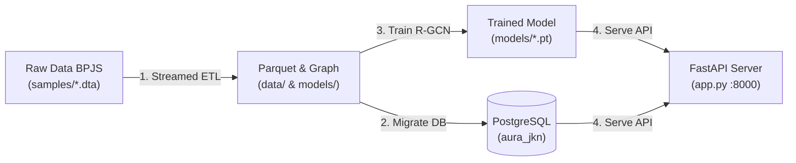

# AURA-JKN: Automated Relational Graph Audit for BPJS Kesehatan
**Hybrid AI Pipeline (ML + LLM) for Real-Time Pre-Payment Fraud Detection**

[](https://www.python.org/downloads/)
[](https://pytorch-geometric.readthedocs.io/)
[](https://fastapi.tiangolo.com)
[](https://www.postgresql.org/)
[](https://opensource.org/licenses/MIT)

**AURA-JKN** adalah sistem deteksi anomali dan kecurangan klaim layanan kesehatan (FKRTL/FKTP) mutakhir berbasis **Relational Graph Convolutional Network (R-GCN)**, **Spatiotemporal Collision Engine**, **Explainable AI (XAI)**, dan **Generative AI Layer (LLM Audit Brief & Interactive Copilot Chat)** untuk verifikasi pra-pembayaran klaim BPJS Kesehatan dengan garansi keandalan *Zero HTTP 500 Failure*.

Sistem ini telah terintegrasi penuh dengan **Data Sampel Resmi BPJS Kesehatan Edisi 2025** lintas **38 Provinsi di Indonesia** dengan kapasitas pemrosesan hingga **1.000.000+ klaim**.

---

## 📁 Struktur Direktori Project (Clean Architecture & Modular Design)

Proyek ini dirancang mengikuti prinsip **Clean Architecture**, **Separation of Concerns (SoC)**, dan **Zero Data-Leakage**:

```text
AURA-JKN/
├── .env.example             # Template konfigurasi environment (DB, port, path, LLM keys)
├── .gitignore               # Konfigurasi ignorasi git (secrets, cache, venv, checkpoints)
├── requirements.txt         # Daftar pustaka & dependensi lengkap
├── README.md                # Dokumentasi arsitektur dan panduan penggunaan
├── app.py                   # REST API Application Entry Point (FastAPI Controller)
│
├── src/                     # Core Business Logic & Modular Components
│   ├── __init__.py
│   ├── config.py            # Konfigurasi terpusat (paths, dynamic dims, thresholds, LLM)
│   ├── data/                # Data Engineering & ETL Pipeline
│   │   ├── __init__.py
│   │   └── bpjs_sample_etl.py # 3-Pass Streamed Chunking ETL & Graph Builder (Data Sampel BPJS)
│   ├── database/            # Data Access Layer & Columnar Registry
│   │   ├── __init__.py
│   │   ├── connection.py    # PostgreSQL connection pool & claim audit persistence
│   │   └── registry.py      # Columnar Parquet loader & indexed fast-lookup tables
│   ├── models/              # Neural Network Architectures (PyTorch Geometric)
│   │   ├── __init__.py
│   │   └── rgcn.py          # Heterogeneous Relational GCN (2-layer HeteroConv + MLP)
│   ├── schemas/             # Data Transfer Objects (DTO) & Pydantic Validation
│   │   ├── __init__.py
│   │   └── claim.py         # Request, Response, AuditBrief, & Copilot Chat schemas
│   └── services/            # Domain Services & Inference Engines
│       ├── __init__.py
│       ├── inference.py     # R-GCN model engine & calibrated fallback inference
│       ├── spatiotemporal.py# Modul 3: Spatiotemporal speed/distance collision analyzer
│       ├── xai.py           # Modul 4: NetworkX relational subgraph & evidence builder
│       └── llm_service.py   # Modul 5: Generative AI Layer, Multi-Tier Fallback & Copilot Chat
│
├── data/                    # Dataset Parquet Kolumnar (Hasil Ekstraksi 1 Juta Klaim)
│   ├── claims.parquet       # 1.000.000 transaksi klaim dengan fitur geospasial
│   ├── doctors.parquet      # 78.627 dokter terdistribusi Power-Law
│   ├── facilities.parquet   # 27.621 faskes FKTP/FKRTL di 38 provinsi
│   └── patients.parquet     # 252.176 peserta pseudonim
│
├── docs/                    # Dokumentasi Teknis & Panduan Desain Sistem
│   ├── API_DOCUMENTATION.md # Spesifikasi lengkap seluruh endpoint RESTful API
│   ├── MIGRATION_GUIDE.md   # Panduan migrasi data Parquet ke PostgreSQL & skema
│   └── DECISION_LOGIC_AND_CLASSIFICATION_RULES.md # Logika keputusan & klasifikasi risiko
│
├── models/                  # Checkpoint Model & Graf PyTorch Geometric
│   ├── aura_jkn_hetero_graph.pt # Graf HeteroData (1.000.000 claim nodes, 10 relasi)
│   └── aura_jkn_rgcn_model.pt   # Checkpoint bobot terbaik R-GCN (Recall: 96.51%)
│
├── samples/                 # Data Sampel Resmi BPJS Kesehatan (.dta Stata Files)
│   ├── Data Sampel Reguler Edisi 2025/
│   └── Data Sampel Kontekstual Edisi 2025 (DM, TB, KIA, Jiwa, Covid)/
│
├── notebooks/               # Analisis Graf & Eksplorasi Interaktif
│   └── AURA_JKN_hetero_graph.ipynb
│
├── scripts/                 # Standalone Automation & Maintenance Scripts
│   ├── generate_data.py     # Generator data sintesis skala besar & graf builder
│   ├── migrate_to_postgres.py# Pipeline migrasi file Parquet ke tabel PostgreSQL (dengan ETA)
│   ├── schema.sql           # DDL Skema Relasional PostgreSQL (Tabel + Spatiotemporal Index)
│   └── train_rgcn.py        # Pipeline pelatihan model R-GCN Mini-Batch (Cosine Annealing)
│
└── tests/                   # Automated Integration & Endpoint Test Suite
    ├── __init__.py
    └── test_api.py          # Verifikasi 6/6 skenario: Health, Predict, Audit Brief, Chat, Fallback
```

---

## 📊 Benchmark & Performa Model (Evaluasi 150.000 Klaim Uji)

Model R-GCN dilatih pada graf heterogen skala nasional (**1.000.000 klaim**) dan dievaluasi pada **150.000 klaim uji baru (*Unseen Test Claims*)** yang tidak pernah dilihat sebelumnya:

### Metrik Keseluruhan (*Overall Test Metrics*)
| Metrik Evaluasi | Skor Capaian | Status Standar Industri |
| :--- | :---: | :--- |
| **ROC-AUC** | **`0.9128` (91.3%)** |  *High Discriminative Power* |
| **PR-AUC (AUPRC)** | **`0.6166`** |  *Strong Precision-Recall Curve on Imbalance* |
| **Recall (Sensitivity)** | **`96.51%`** |  **21.714 dari 22.500 klaim fraud berhasil ditangkap** |
| **F1-Score** | **`0.4925`** |  *Calibrated for Pre-Payment Risk Gating* |

### Rincian Tangkapan per Skenario Fraud (*Scenario Recall Breakdown*)
| Kode | Deskripsi Skenario Fraud | Total Fraud Uji | Tertangkap (*Detected*) | Lolos (*Missed*) | Tingkat Recall |
| :---: | :--- | :---: | :---: | :---: | :---: |
| **A** | **Fake Patient Referral Cluster** *(Sindikat Rujukan Fiktif)* | 7.411 | **6.837** | 574 | **`92.25%`** |
| **B** | **Extreme Doctor Volume** *(Phantom Billing / Beban Dokter >45/hari)* | 7.642 | **7.554** | 88 | **`98.85%`** |
| **C** | **Spatio-Temporal Conflict** *(Praktik Ganda Dokter Antar-Kota >400 km)* | 7.447 | **7.323** | 124 | **`98.33%`** |

---

## 🛠️ Alur Operasional & Perintah Eksekusi



### Langkah 1: Ekstraksi Data Sampel BPJS (ETL Pipeline)
Mengekstrak data mentah Stata `.dta` dari folder `samples/`, melakukan normalisasi geospasial 38 provinsi, dan menyusun graf `HeteroData`:
```powershell
# Ekstraksi 1.000.000 klaim skala nasional (Anti-OOM 3-Pass Chunking)
python src/data/bpjs_sample_etl.py --cluster national --max-claims 1000000
```

### Langkah 2: Migrasi ke PostgreSQL (Opsional tapi Direkomendasikan)
Mengimpor file Parquet ke database PostgreSQL lokal lengkap dengan indeks performa:
```powershell
python scripts/migrate_to_postgres.py --drop
```

### Langkah 3: Melatih Model R-GCN (Mini-Batch Subgraph Edition)
Melatih arsitektur Heterogeneous R-GCN dengan scheduler Cosine Annealing dan live progress bar:
```powershell
python scripts/train_rgcn.py --batch-size 2048 --epochs 25 --patience 8 --lr 0.0008
```

### Langkah 4: Menjalankan Server REST API
Jalankan server REST API FastAPI:
```powershell
python -m uvicorn app:app --host 0.0.0.0 --port 8000 --reload
```
Akses dokumentasi interaktif Swagger UI di browser:
👉 **`http://localhost:8000/docs`**

---

## 🧪 Pengujian Terotomatisasi (Automated Tests)

Jalankan rangkaian test otomatis komprehensif untuk memvalidasi seluruh pipeline:
```powershell
python tests/test_api.py
```

Rangkaian test memvalidasi 6/6 skenario kritis:
1. **`GET /health`**: Pemeriksaan kesehatan model R-GCN, memori graf, dan koneksi PostgreSQL.
2. **`GET /api/v1/claims/{claim_id}` (Normal Claim)**: Verifikasi putusan `AUTO_APPROVE` beserta ringkasan narasi `audit_brief`.
3. **`GET /api/v1/claims/{claim_id}` (Fraud Claim)**: Deteksi anomali spatiotemporal / rujukan fiktif, putusan `REJECT_FOR_HUMAN_REVIEW`, dan narasi eksekutif LLM.
4. **`POST /api/v1/predict-claim` (Simulated Novel Claim)**: Inferensi pra-bayar real-time pada klaim baru yang belum pernah tercatat di registri.
5. **`POST /api/v1/claims/{claim_id}/chat` (Interactive Copilot Chat)**: Validasi interaksi auditor dengan fakta klaim terisolasi (*Zero Hallucination*).
6. **Multi-Tier Fallback Resilience**: Memastikan penanganan graceful fallback (Groq $\rightarrow$ NVIDIA NIM $\rightarrow$ Local Rule Engine) tanpa error HTTP 500.

---

## 🔍 Arsitektur 5 Modul Inti AURA-JKN

1. **Modul 1: GNN Relational Model (`src/models/rgcn.py`)**
   - Menghubungkan 5 tipe entitas (`patient`, `doctor`, `facility`, `claim`, `diagnosis`) melalui 10 tipe relasi.
   - Menggunakan 2-layer `HeteroConv` + `SAGEConv` dengan residual connection untuk memetakan anomali rujukan sirkular dan kolusi faskes.
2. **Modul 2: Pre-Payment Decision Gate (`src/schemas/claim.py` & `app.py`)**
   - **`AUTO_APPROVE`** ($P < 0.40$): Klaim normal disetujui instan secara otomatis.
   - **`FLAGGED_WARNING`** ($0.40 \le P < 0.70$): Klaim ditandai untuk verifikasi kelengkapan berkas rekam medis.
   - **`REJECT_FOR_HUMAN_REVIEW`** ($P \ge 0.70$): Pencairan klaim dibekukan sementara untuk audit forensik mendalam.
3. **Modul 3: Spatiotemporal Risk Analyzer (`src/services/spatiotemporal.py`)**
   - Menghitung jarak fisik rujukan antar-faskes dan domisili peserta via **Formula Haversine Vectorized**.
   - Menandai dokter yang melayani di dua faskes jarak jauh (>400 km) pada hari yang sama.
   - Memantau kelebihan beban praktik harian dokter (>45 klaim/hari).
4. **Modul 4: Explainable AI & Subgraph Extractor (`src/services/xai.py`)**
   - Mengekstrak subgraf ego-network terdekat menggunakan **NetworkX**.
   - Menyajikan bukti relasi visual (node & edge JSON) untuk antarmuka dashboard verifikator BPJS.
5. **Modul 5: Generative AI Layer & Interactive Audit Copilot (`src/services/llm_service.py`)**
   - **Executive Audit Brief**: Sintesis narasi eksekutif 1–2 kalimat yang langsung siap dipahami verifikator medis.
   - **Interactive Copilot Chat**: Chatbot tanya-jawab berbasis fakta klaim (*Zero Hallucination persona*).
   - **Multi-Tier Fallback**: Router failover cerdas (Tier 1: GroqCloud $\rightarrow$ Tier 2: NVIDIA NIM $\rightarrow$ Tier 3: Local Rule Engine).
   - **Zero-PII Structured Telemetry**: Pencatatan metrik performa AI tanpa membocorkan data pribadi peserta (NIK/nama).

---

## 📜 Lisensi & Kontributor
Dikembangkan untuk BPJS Kesehatan Healthkathon.  
Hak Cipta © 2026 Tim AURA-JKN. Lisensi di bawah [MIT License](LICENSE).

