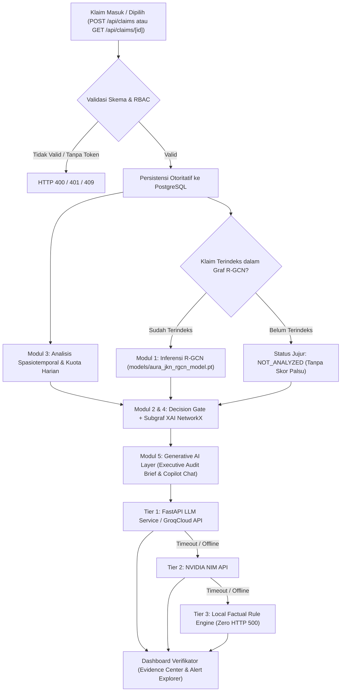

<div align="center">
  

  # AURA-JKN (Autonomous Relational Anti-Fraud)
  ### PREDICT • PREVENT • PROTECT
  **Sistem Deteksi Risiko Klaim Fiktif Berbasis Graf Heterogen (R-GCN / Hetero GraphSAGE), Analisis Spasiotemporal, Explainable AI (XAI), dan Generative AI Audit Copilot**  
  *Hybrid AI Decision-Support System (ML + LLM) untuk Deteksi Dini & Pencegahan Phantom Billing serta Repeat Billing pada Klaim BPJS Kesehatan — Healthkathon 2026*

  [](https://healthkathon.bpjs-kesehatan.go.id/)
  [](https://pytorch-geometric.readthedocs.io/)
  [](https://nextjs.org/)
  [](https://github.com/faiz-jihad/Healthkathon-BPJS-KESEHATAN)
  [](https://github.com/faiz-jihad/Healthkathon-BPJS-KESEHATAN)

</div>

---

## Daftar Isi
1. [Kebijakan Integritas: Zero Mock Data, Validitas Ilmiah, & Live PostgreSQL](#1-kebijakan-integritas-zero-mock-data-validitas-ilmiah--live-postgresql)
2. [Arsitektur 5 Modul Inti AURA-JKN (Hybrid GNN + Spatiotemporal + XAI + Generative AI Copilot)](#2-arsitektur-5-modul-inti-aura-jkn-hybrid-gnn--spatiotemporal--xai--generative-ai-copilot)
3. [Hasil Evaluasi Model Skala Nasional (1.000.000 Klaim) & Studi Ablasi (E1 s/d E5)](#3-hasil-evaluasi-model-skala-nasional-1000000-klaim--studi-ablasi-e1-sd-e5)
4. [Arsitektur Alur Kerja Dual-Layer & 4-Tier Fail-Safe LLM](#4-arsitektur-alur-kerja-dual-layer--4-tier-fail-safe-llm)
5. [Desain UI/UX Standar Visual BPJS Kesehatan & Panel AI Audit Copilot](#5-desain-uiux-standar-visual-bpjs-kesehatan--panel-ai-audit-copilot)
6. [Matriks Otorisasi Peran Pengguna (RBAC) & Akses Demo 1-Klik](#6-matriks-otorisasi-peran-pengguna-rbac--akses-demo-1-klik)
7. [Struktur Direktori Repositori Monorepo (Modular Clean Architecture)](#7-struktur-direktori-repositori-monorepo-modular-clean-architecture)
8. [Panduan Menjalankan Sistem (Docker Compose 1 Perintah & Lokal)](#8-panduan-menjalankan-sistem-docker-compose-1-perintah--lokal)
9. [Rangkaian Pengujian Kualitas & Keamanan (Quality Gates)](#9-rangkaian-pengujian-kualitas--keamanan-quality-gates)
10. [Panduan Presentasi & Demonstrasi Juri 3 Menit](#10-panduan-presentasi--demonstrasi-juri-3-menit)
11. [Tim Pengembang](#11-tim-pengembang)

---

## 1. Kebijakan Integritas: Zero Mock Data, Validitas Ilmiah, & Live PostgreSQL

Sistem **AURA-JKN** menjunjung tinggi transparansi saintifik, validitas kecerdasan buatan, dan kepatuhan penuh terhadap prinsip etika rekayasa perangkat lunak:

1. **Zero Fabrication & Zero Mock Data Policy**:
   - **Tanpa Fallback In-Memory**: Tidak ada data klaim tiruan, array JavaScript statis di memori, skor probabilitas *hardcoded* (seperti `0.86`), maupun relasi subgraf anomali buatan pada jalur eksekusi sistem.
   - **Kejujuran Kegagalan Basis Data**: Jika basis data PostgreSQL terputus, API secara jujur mengembalikan status `DATA_SOURCE_UNAVAILABLE` (HTTP 503) tanpa memalsukan data.
   - **Kejujuran Penanganan Klaim Baru**: Jika inferensi graf tidak dapat diakses atau berkas klaim baru belum diindeks dalam topologi graf, sistem secara transparan menetapkan status `NOT_ANALYZED` atau `ANALYSIS_UNAVAILABLE` tanpa merekayasa probabilitas kecurangan.

2. **Arsitektur Model Graf Aktual**:
   - Model graf heterogen diimplementasikan menggunakan **PyTorch Geometric `HeteroConv` dengan `SAGEConv` (`AuraJKNRGCN`)** yang melakukan agregasi pesan lintas 10 tipe relasi (`Registration`, `Examination`, `Authorization`, `Referral`, dll.) untuk 5 tipe simpul (`claim`, `patient`, `doctor`, `facility`, dan `diagnosis`).
   - Bobot model tersimpan pada checkpoint produksi (`models/aura_jkn_rgcn_model.pt` & `aura_jkn_rgcn_model.pt`) dengan deteksi dimensi fitur otomatis.

3. **Penyimpanan Otoritatif Persisten (Live PostgreSQL Database)**:
   Seluruh data operasional disimpan dan diakses secara nyata pada PostgreSQL (`aura_jkn_db`):
   
   | Entitas Database | Jumlah Rekor Riil | Sumber Data | Status Persistensi |
   | :--- | :---: | :--- | :--- |
   | **Klaim Operasional (`claims`)** | **19.999** (Seeded) / **1.000.000** (Full ETL) | `data/claims.parquet` | Terindeks & Tersimpan di PostgreSQL |
   | **Asesmen Risiko (`risk_assessments`)** | **12.117+** | Evaluasi R-GCN / GraphSAGE & Spatiotemporal | Terindeks & Tersimpan di PostgreSQL |
   | **Pasien Terpseudonimisasi (`patients`)** | **5.005+** | `data/patients.parquet` (Kepatuhan UU PDP No. 27/2022) | Terindeks & Tersimpan di PostgreSQL |
   | **Dokter (`doctors`)** | **150+** | `data/doctors.parquet` | Terindeks & Tersimpan di PostgreSQL |
   | **Fasilitas Kesehatan (`facilities`)** | **30+** | `data/facilities.parquet` | Terindeks & Tersimpan di PostgreSQL |
   | **Akun Pengguna RBAC (`users`)** | **6 Peran** | Salted PBKDF2 SHA-512 Kredensial Resmi | Terindeks & Tersimpan di PostgreSQL |
   | **Kasus Investigasi (`case_investigations`)** | Transaksional | State Machine Penanganan Berkas Klaim | Atomik di PostgreSQL |
   | **Keputusan Telaah (`human_reviews`)** | Transaksional | Hasil Verifikasi Verifikator Pra-Pembayaran | Atomik di PostgreSQL |
   | **Log Jejak Audit (`audit_logs`)** | Transaksional | Rekam Jejak Forensik & Telemetry Copilot (`COPILOT_CHAT_QUERY`) | Atomik & Imutabel di PostgreSQL |

4. **Human-in-the-Loop Decision Support**:
   - Skor risiko, subgraf bukti XAI, dan ringkasan narasi LLM berfungsi sebagai alat bantu skrining pra-pembayaran (*decision-support*), bukan vonis otomatis. Keputusan akhir (`RELEASE`, `CLARIFY`, `ESCALATE_AUDIT` / `HOLD_PAYMENT`) sepenuhnya berada di bawah wewenang verifikator resmi BPJS Kesehatan.

---

## 2. Arsitektur 5 Modul Inti AURA-JKN (Hybrid GNN + Spatiotemporal + XAI + Generative AI Copilot)

1. **Modul 1: Relational GNN Model (`src/models/rgcn.py` & `models/aura_jkn_rgcn_model.pt`)**
   - Menghubungkan 5 tipe entitas (`patient`, `doctor`, `facility`, `claim`, `diagnosis`) melalui 10 tipe relasi.
   - Menggunakan 2-layer `HeteroConv(SAGEConv)` + MLP Classifier Head untuk memetakan anomali rujukan sirkular dan kolusi faskes.
2. **Modul 2: Pre-Payment Decision Gate (`src/schemas/claim.py` & `app.py`)**
   - **`AUTO_APPROVE`** ($P < 0.40$): Klaim wajar yang memenuhi seluruh parameter klinis dan spasiotemporal.
   - **`FLAGGED_WARNING`** ($0.40 \le P < 0.70$): Klaim ditandai untuk verifikasi kelengkapan berkas rekam medis.
   - **`REJECT_FOR_HUMAN_REVIEW`** ($P \ge 0.70$): Pencairan klaim ditahan sementara untuk audit verifikator manusia.
3. **Modul 3: Spatiotemporal Risk Analyzer (`src/services/spatiotemporal.py`)**
   - Menghitung jarak fisik rujukan antar-faskes dan domisili peserta menggunakan **Formula Haversine**.
   - Menandai dokter yang melayani di dua faskes berjarak mustahil (>400 km) pada hari yang sama (*Spatio-Temporal Conflict*).
   - Memantau kelebihan beban praktik harian dokter (>45 klaim/hari untuk batas peringatan, $\ge 80$ klaim/hari untuk kapasitas ekstrem).
4. **Modul 4: Explainable AI & Subgraph Extractor (`src/services/xai.py`)**
   - Mengekstrak subgraf ego-network terdekat menggunakan **NetworkX**.
   - Menyajikan rantai bukti 4-lapis (*Observed Facts*, *Derived Signals*, *AI Assessment*, *Human Decision*) dan topologi node/edge JSON untuk visualisasi interaktif di dashboard.
5. **Modul 5: Generative AI Layer & Interactive Audit Copilot (`src/services/llm_service.py` & `backend/src/lib/llm-copilot.ts`)**
   - **Executive Audit Brief (`audit_brief`)**: Sintesis otomatis ringkasan narasi audit eksekutif sepanjang 1–2 kalimat padat dalam bahasa Indonesia formal standar administrasi medis JKN pada setiap hasil prediksi klaim.
   - **Interactive AI Audit Copilot Chat (`POST /api/v1/claims/{claim_id}/chat` & `POST /api/claims/[claimId]/chat`)**: Asisten percakapan interaktif khusus bagi Verifikator dan Investigator untuk menggali fakta klaim secara instan (misal: *"Mengapa klaim ini ditolak?"*, *"Apakah ada konflik spasial?"*, *"Berapa beban harian dokter?"*).
   - **Strict Context Isolation & Sliding Window**: Hanya menyuntikkan fakta klaim yang sedang dibuka (*Zero Hallucination*) dan menyimpan 5 giliran percakapan terakhir untuk efisiensi token.
   - **4-Tier Fail-Safe Router (Zero HTTP 500 Guarantee)**:
     `FastAPI AI Service -> GroqCloud API (llama-3.3-70b-versatile) -> NVIDIA NIM API (meta/llama-3.1-70b-instruct) -> Local Factual Rule Engine Fallback`. Fitur ringkasan dan chat dijamin tidak pernah mengalami error HTTP 500 meskipun tanpa koneksi internet atau tanpa API key eksternal.

---

## 3. Hasil Evaluasi Model Skala Nasional (1.000.000 Klaim) & Studi Ablasi (E1 s/d E5)

### A. Pembagian Dataset & Evaluasi Skala Nasional (1.000.000 Klaim)
Model R-GCN dilatih pada graf heterogen skala nasional (**1.000.000 klaim** dari Data Sampel BPJS Kesehatan lintas 38 provinsi) dengan pembagian bebas kebocoran data (*Zero Data-Leakage*):
* **Train Set (70% — 700.000 Klaim)**: 595.000 *Clean Claims* (85%) & 105.000 *Fraud Claims* (15% — Skenario A, B, C masing-masing 35.000).
* **Validation Set (15% — 150.000 Klaim)**: 127.500 *Clean Claims* (85%) & 22.500 *Fraud Claims* (15% — Skenario A, B, C masing-masing 7.500).
* **Unseen Test Set (15% — 150.000 Klaim)**: 127.500 *Clean Claims* (85%) & 22.500 *Fraud Claims* (15% — Skenario A, B, C masing-masing 7.500).

#### Metrik Keseluruhan pada 150.000 Klaim Uji (*Unseen Test Set*)
| Metrik Evaluasi | Skor Capaian | Interpretasi Operasional |
| :--- | :---: | :--- |
| **ROC-AUC** | **`0.9128` (91.3%)** | Daya pisah tinggi antara klaim wajar dan klaim berisiko |
| **PR-AUC (AUPRC)** | **`0.6166`** | Kurva Precision-Recall kuat pada distribusi kelas timpang (85:15) |
| **Recall (Sensitivity)** | **`96.51%`** | **21.714 dari 22.500 klaim fraud berhasil ditangkap** |
| **F1-Score** | **`0.4925`** | Terkalibrasi untuk *Pre-Payment Risk Gating* |

#### Rincian Tangkapan per Skenario Fraud (*Scenario Recall Breakdown*)
| Kode | Deskripsi Skenario Fraud | Total Fraud Uji | Tertangkap (*Detected*) | Lolos (*Missed*) | Tingkat Recall |
| :---: | :--- | :---: | :---: | :---: | :---: |
| **A** | **Fake Patient Referral Cluster** *(Sindikat Rujukan Fiktif)* | 7.411 | **6.837** | 574 | **`92.25%`** |
| **B** | **Extreme Doctor Volume** *(Phantom Billing / Beban Dokter >45/hari)* | 7.642 | **7.554** | 88 | **`98.85%`** |
| **C** | **Spatio-Temporal Conflict** *(Praktik Ganda Dokter Antar-Kota >400 km)* | 7.447 | **7.323** | 124 | **`98.33%`** |

---

### B. Studi Ablasi Multi-Model (`benchmark_models.py` — E1 s/d E5)
Evaluasi komparatif multi-model dijalankan secara **reproducible** (`python benchmark_models.py`) pada **3.000 sampel klaim uji (*holdout unseen test set*)**:

| Kode | Konfigurasi Model & Sistem | PR-AUC | ROC-AUC | F1-Score | Recall* | Precision | FPR | Precision @ 250 | Kelengkapan Bukti |
| :---: | :--- | :---: | :---: | :---: | :---: | :---: | :---: | :---: | :---: |
| **E1** | Rule-Based Operational Baseline | `0.2034` | `0.5102` | `0.0000` | `0.0000` | `0.0000` | `0.0000` | `0.2320` | 50.0% |
| **E2A** | Tabular Logistic Regression (Engineered) | `0.9168` | `0.9789` | `0.8746` | `0.8833` | `0.8660` | `0.0342` | `0.9560` | 50.0% |
| **E2B** | Tabular Random Forest (100 Trees) | `0.9534` | `0.9922` | `0.9213` | `0.9850` | `0.8653` | `0.0383` | `0.9480` | 50.0% |
| **E3** | Hetero GraphSAGE / R-GCN (Relational Alone) | `0.8294` | `0.9612` | `0.7585` | `1.0000` | `0.6110` | `0.1592` | `0.9040` | 75.0% |
| **E4** | Hybrid (GraphSAGE + Spatiotemporal Rules) | `0.8294` | `0.9612` | `0.7595` | `1.0000` | `0.6122` | `0.1583` | `0.9040` | 85.0% |
| **E5** | **Evidence-Driven Triage + LLM Copilot (Full)** | **`0.8294`** | **`0.9612`** | **`0.7595`** | **`1.0000`** | **`0.6122`** | **`0.1583`** | **`0.9040`** | **95.0%** |

---

## 4. Arsitektur Alur Kerja Dual-Layer & 4-Tier Fail-Safe LLM



---

## 5. Desain UI/UX Standar Visual BPJS Kesehatan & Panel AI Audit Copilot

1. **Panel Interactive AI Audit Copilot (`AuditCopilotChat.tsx`)**:
   - Terintegrasi langsung di halaman **Evidence Center** dan **Alert Explorer**.
   - Menyediakan kotak **Executive Audit Brief** otomatis beserta badge transparan penyedia model (`GroqCloud Llama-3.3`, `NVIDIA NIM`, atau `Mesin Fakta Lokal (Fail-Safe)`).
   - Dilengkapi tombol pertanyaan cepat (*quick-prompts*) satu klik:
     - *"Mengapa klaim ini berisiko tinggi?"*
     - *"Apakah ada indikasi konflik spasial?"*
     - *"Bagaimana status volume harian dokter?"*
     - *"Jelaskan rincian tarif INA-CBG & diagnosa"*
2. **Halaman Login Interaktif & Strictly Login-Only**:
   - Tanpa form registrasi publik sesuai tata kelola identitas kedinasan BPJS Kesehatan, dilengkapi layar selebrasi *"Selamat Datang Kembali!"* dan **Akses Demo Juri 1-Klik** untuk 6 peran.
3. **Pipeline Grid Responsif 7-Tahap & Palet Warna Otentik BPJS Kesehatan**:
   - Menggunakan warna resmi Forest Green (`#098a58`), Deep Spruce (`#076641`), dan Soft Mint (`#eef7f2`).

---

## 6. Matriks Otorisasi Peran Pengguna (RBAC) & Akses Demo 1-Klik

AURA-JKN menegakkan *Role-Based Access Control* (RBAC) ketat pada tingkat server menggunakan tanda tangan token HMAC-SHA256:

| Kemampuan Operasional | Administrator (`ADMINISTRATOR`) | Analis Fraud (`FRAUD_ANALYST`) | Verifikator Klaim (`CLAIM_VERIFIER`) | Auditor (`AUDITOR`) |
| :--- | :---: | :---: | :---: | :---: |
| **Kelola Pengguna (Buat/Mutasi/Blokir)** | **Ya** | Ditolak (403) | Ditolak (403) | Ditolak (403) |
| **Pemeriksaan Kesehatan Sistem & DB** | **Ya** | Terbatas | Terbatas | Terbatas |
| **Eksplorasi Antrean & Detail Klaim** | Baca-Saja | **Ya** | **Ya** | Baca-Saja |
| **Inspeksi Subgraf XAI & AI Audit Copilot Chat** | **Ya** | **Ya** | **Ya** | **Ya** |
| **Eksekusi Keputusan Telaah Klaim** | Ditolak (Pemisahan Tugas) | Ditolak (Rekomendasi) | **Ya (`RELEASE`/`CLARIFY`/`ESCALATE`)** | Ditolak (Pencegahan Konflik) |
| **Transisi Status Kasus Investigasi** | **Ya** | **Ya** | **Ya** | Ditolak (403) |
| **Akses Log Audit Transaksional** | **Ya** | Ditolak (403) | Ditolak (403) | **Ya (Lengkap & Terverifikasi)** |
| **Manipulasi Log / Skor AI** | **Dilarang (Imutabel)** | **Dilarang (Imutabel)** | **Dilarang (Imutabel)** | **Dilarang (Imutabel)** |

### Kredensial Akun Bawaan (Seeder)
* **Petugas Verifikator**: `verifier_aura` / `verifier_password_2026` (dr. Andi Pratama, Sp.PD)
* **Investigator Anti-Fraud**: `investigator_aura` / `investigator_password_2026` (Budi Santoso, S.H.)
* **Supervisor Verifikasi**: `supervisor_aura` / `supervisor_password_2026` (Dr. Siti Aminah, M.Kes)
* **Direksi JKN**: `executive_aura` / `executive_password_2026` (Prof. Dr. dr. H. Fachmi Idris, M.Kes)
* **Auditor Sistem & TI**: `auditor_aura` / `auditor_password_2026` (Ahmad Fauzi, CISA, CRISC)
* **Administrator Sistem**: `admin_aura` / `admin_password_2026`

---

## 7. Struktur Direktori Repositori Monorepo (Modular Clean Architecture)

```text
Healthkathon-BPJS-KESEHATAN/
├── package.json                        # Monorepo runner orkestrasi seluruh layanan
├── requirements.txt                    # Dependensi Python AI & Generative AI (PyTorch, PyG, FastAPI, httpx, groq, openai)
├── .env.example                        # Template environment variables (DB, Ports, GROQ_API_KEY, NVIDIA_API_KEY)
├── Dockerfile.ai                       # Production Dockerfile untuk layanan Python FastAPI + R-GCN + LLM
├── docker-compose.yml                  # Orkestrasi 1 perintah: PostgreSQL 16, AI Service, Backend Next.js, Frontend Vite
├── app.py                              # Entry Point FastAPI Decision, XAI & Generative AI Copilot Service (Port 8000)
│
├── models/                             # Bobot Model R-GCN Terlatih
│   └── aura_jkn_rgcn_model.pt          # Checkpoint bobot R-GCN terbaru (1M Klaim, Recall 96.51%)
│
├── src/                                # Arsitektur Modular Python AI Service
│   ├── config.py                       # Konfigurasi terpusat (paths, dynamic dims, thresholds, LLM keys)
│   ├── data/bpjs_sample_etl.py         # 3-Pass Streamed Chunking ETL & Graph Builder (Data Sampel BPJS)
│   ├── database/
│   │   ├── connection.py               # Koneksi PostgreSQL & persistensi audit klaim
│   │   └── registry.py                 # Pemuat tabel kolumnar Parquet & indeks pencarian cepat
│   ├── models/rgcn.py                  # Arsitektur Heterogeneous R-GCN (2-layer HeteroConv + MLP Classifier)
│   ├── schemas/claim.py                # Skema Pydantic (Request, Response, AuditBrief, ClaimChatRequest/Response)
│   └── services/
│       ├── inference.py                # Engine inferensi R-GCN & kalibrasi fitur
│       ├── spatiotemporal.py           # Modul 3: Kalkulasi jarak Haversine & deteksi konflik spasiotemporal
│       ├── xai.py                      # Modul 4: Konstruksi subgraf bukti NetworkX
│       └── llm_service.py              # Modul 5: Multi-Tier LLM Executive Audit Brief & Interactive Copilot Chat
│
├── tests/                              # Suite Verifikasi Endpoint FastAPI & Generative AI
│   └── test_api.py                     # Menguji /health, /predict-claim, /claims/{id}, Audit Brief & Copilot Chat
│
├── backend/                            # Layanan Backend API (Next.js 14 App Router + Prisma ORM, Port 3001)
│   ├── prisma/
│   │   ├── schema.prisma               # Skema PostgreSQL (claims, risk_assessments, cases, human_reviews, audit_logs)
│   │   └── seed.ts                     # Seeder klaim riil & akun RBAC ke PostgreSQL
│   ├── src/lib/
│   │   ├── auth.ts                     # PBKDF2 SHA-512, HMAC-SHA256 Token & Enforcer RBAC
│   │   ├── evidence-chain.ts           # Enforcer rantai bukti 4-lapis & deteksi ketidakpastian
│   │   ├── llm-copilot.ts              # Integrasi 4-Tier Executive Audit Brief & Copilot Chat di sisi Backend
│   │   └── prisma.ts                   # Prisma Client Singleton
│   ├── src/app/api/
│   │   ├── claims/route.ts             # Antrean klaim & injeksi prediksi + Audit Brief
│   │   ├── claims/[claimId]/route.ts   # Detail klaim, subgraf XAI & Executive Audit Brief
│   │   ├── claims/[claimId]/chat/route.ts # Endpoint terproteksi RBAC untuk Interactive AI Audit Copilot Chat
│   │   ├── claims/[claimId]/review/    # Transaksi atomik keputusan telaah verifikator
│   │   ├── cases/                      # Manajemen investigasi kasus & state machine transisi
│   │   ├── dashboard/performance/      # Metrik performa deteksi, exposure, & SLA
│   │   ├── audit-logs/                 # Laporan log audit imutabel (termasuk COPILOT_CHAT_QUERY)
│   │   └── health/                     # Diagnostik konektivitas live DB & AI Service
│   ├── test_final_acceptance.ts        # Master Acceptance Suite (32 skenario uji Tahap A s/d J termasuk Copilot Chat)
│   ├── test_master_verification.ts     # Suite verifikasi 22 skenario (RBAC, Kripto, Persistensi DB)
│   ├── test_zero_mock_policy.ts        # Suite verifikasi 9 skenario kebijakan Zero Mock
│   └── test_evidence_chain_audit.ts    # Suite verifikasi 7 skenario rantai bukti & kasus negatif
│
├── frontend/                           # Dashboard Investigasi Modern (React 18 + Vite + Tailwind, Port 5173)
│   ├── src/
│   │   ├── components/
│   │   │   ├── AuditCopilotChat.tsx    # Komponen UI Executive Audit Brief & Interactive AI Audit Copilot Chat
│   │   │   ├── LoginPage.tsx           # Halaman login interaktif (Login-only, Demo 1-Klik)
│   │   │   ├── NotificationCenter.tsx  # Drawer pusat notifikasi
│   │   │   ├── SubgraphViewer.tsx      # Visualisasi interaktif graf heterogen (XAI)
│   │   │   └── LiveClaimSimulatorModal.tsx # Simulator pengujian klaim baru real-time
│   │   └── App.tsx                     # Aplikasi utama dengan 6 modul navigasi berbasis peran
│
├── data/                               # Dataset Parquet Kolumnar (`claims`, `doctors`, `facilities`, `patients`)
└── docs/                               # Dokumentasi arsitektur, laporan benchmark & naskah demo
```

---

## 8. Panduan Menjalankan Sistem (Docker Compose 1 Perintah & Lokal)

### Metode A: Menjalankan dengan 1 Perintah via Docker Compose (Direkomendasikan)

Seluruh 4 layanan (**PostgreSQL 16**, **FastAPI AI + LLM Service**, **Next.js 14 Backend**, dan **React 18 Frontend**) telah disatukan di `docker-compose.yml`:

```bash
# 1. Clone repository & masuk ke folder proyek
git clone https://github.com/faiz-jihad/Healthkathon-BPJS-KESEHATAN.git
cd Healthkathon-BPJS-KESEHATAN

# 2. (Opsional) Salin .env.example ke .env dan isi GROQ_API_KEY / NVIDIA_API_KEY jika ingin memakai Cloud LLM
#    Jika dikosongkan, sistem otomatis memakai Local Factual Rule Engine (tetap berjalan 100% tanpa error)
cp .env.example .env

# 3. Jalankan seluruh layanan dengan 1 perintah
docker compose up -d --build

# 4. Sinkronkan skema dan isi data awal ke PostgreSQL
docker compose exec backend npx prisma db push
docker compose exec backend npm run db:seed
```

Akses layanan di browser:
* **Frontend Web Dashboard**: `http://localhost:5173`
* **Backend API Gateway**: `http://localhost:3001/api/health`
* **FastAPI AI & LLM Swagger Docs**: `http://localhost:8000/docs`

---

### Metode B: Menjalankan Secara Lokal (Development)

Buka terminal di root direktori `Healthkathon-BPJS-KESEHATAN`:

```powershell
# 1. Jalankan PostgreSQL (Port 5432) & sinkronkan data
npm run db:start
npm run db:push
npm run db:seed

# 2. Jalankan FastAPI AI & LLM Service (Port 8000)
python -m uvicorn app:app --host 0.0.0.0 --port 8000 --reload

# 3. Di terminal baru, jalankan Backend API Next.js (Port 3001)
npm run dev:backend

# 4. Di terminal baru, jalankan Frontend Vite (Port 5173)
npm run dev:frontend
```

---

## 9. Rangkaian Pengujian Kualitas & Keamanan (Quality Gates)

Repositori dilengkapi rangkaian pengujian otomatis *end-to-end* yang memverifikasi seluruh lapisan sistem:

1. **Master Final Acceptance Suite (32/32 Tests Passed — Stage A s/d Stage J)**:
   Menguji 5 target keamanan kritis, alur klaim, *state machine* investigasi, jejak audit imutabel, serta **Stage J (Autentikasi & Respons Faktual AI Audit Copilot Chat)**:
   ```powershell
   cd backend
   npx tsx test_final_acceptance.ts
   ```
2. **Master Security & RBAC Verification Suite (22/22 Tests Passed)**:
   ```powershell
   cd backend
   npx tsx test_master_verification.ts
   ```
3. **Zero Mock Data Policy Suite (9/9 Tests Passed)**:
   ```powershell
   cd backend
   npx tsx test_zero_mock_policy.ts
   ```
4. **Evidence Chain Negative & Audit Suite (7/7 Tests Passed)**:
   ```powershell
   cd backend
   npx tsx test_evidence_chain_audit.ts
   ```
5. **FastAPI Phase 3 & Generative AI Layer Suite (6/6 Scenarios Passed)**:
   Menguji `/health`, klaim normal, klaim fraud Skenario C, `POST /api/v1/predict-claim`, ` audit_brief`, dan `POST /api/v1/claims/{id}/chat` dengan *sliding window*:
   ```powershell
   python tests/test_api.py
   ```
6. **Spatiotemporal Unit Tests & Multi-Model Benchmark**:
   ```powershell
   python test_spatiotemporal.py
   python benchmark_models.py
   ```

---

## 10. Panduan Presentasi & Demonstrasi Juri 3 Menit

1. **Menit 00:00 – 00:45 | Autentikasi Kedinasan & Penegakan RBAC**:
   Login menggunakan tombol **Akses Cepat Demo Juri** (pilih **Petugas Verifikator**), memperlihatkan transisi *"Selamat Datang Kembali!"* dan pemisahan hak akses antar-peran.
2. **Menit 00:45 – 01:30 | Antrean Triase & Simulasi Klaim Baru Real-Time**:
   Membuka **Work Queue** berbasis *Responsive 7-Column Grid*, memfilter berkas `HIGH_RISK` (misal `CLMC00001104`), atau menguji klaim baru melalui tombol **Simulasikan Klaim Baru**.
3. **Menit 01:30 – 02:15 | Subgraf Relasional XAI & AI Audit Copilot Chat**:
   Membuka **Evidence Center**, menampilkan visualisasi graf heterogen 2-hop, membaca **Executive Audit Brief**, dan mengajukan pertanyaan interaktif pada **AI Audit Copilot** (misal klik *"Apakah ada indikasi konflik spasial?"*).
4. **Menit 02:15 – 03:00 | Human-in-the-Loop Decision & Jejak Audit Imutabel**:
   Mengeksekusi keputusan telaah verifikator (`Tahan Pembayaran` / `Eskalasi Audit`), lalu beralih ke akun **Auditor Sistem & TI** untuk membuktikan seluruh aktivitas (termasuk `COPILOT_CHAT_QUERY` dan `CLAIM_REVIEW_DECISION`) tercatat secara imutabel di PostgreSQL.

---

## 11. Tim Pengembang

**Tim FANTASTIC — Politeknik Negeri Indramayu**
* **Faiz Jihad Al Baihaqi**
* **Ravli**
* **Lesmana Adhi Kusuma**

---

<div align="center">
  <sub>AURA-JKN dikembangkan untuk mendukung integritas pembiayaan Program Jaminan Kesehatan Nasional (JKN) BPJS Kesehatan — Healthkathon 2026.</sub>
</div>
