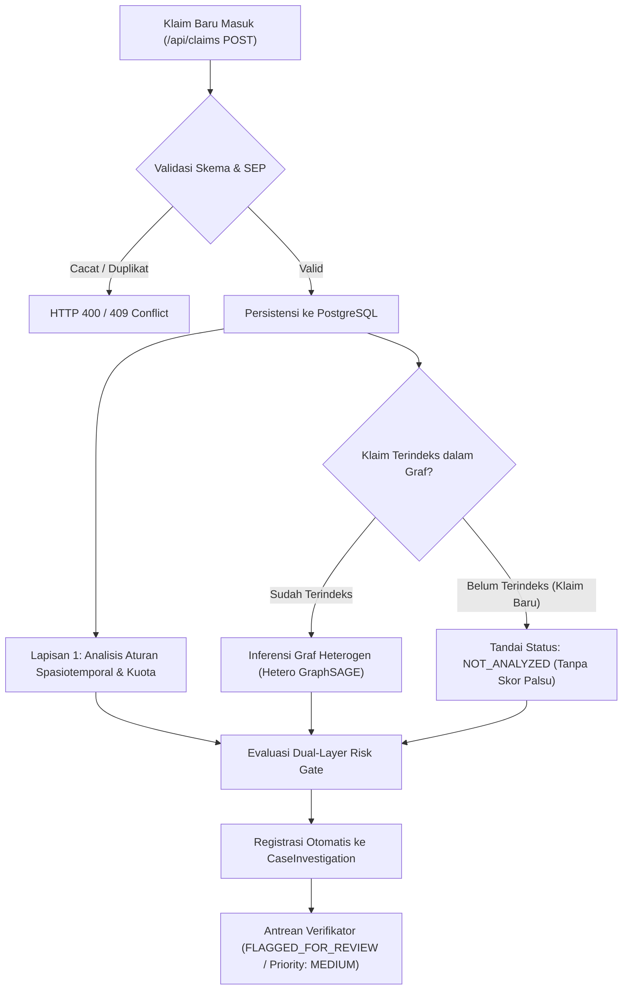

<div align="center">
  

  # AURA-JKN (Autonomous Relational Anti-Fraud)
  ### PREDICT • PREVENT • PROTECT
  **Sistem Deteksi Risiko Klaim Fiktif Berbasis Graf Heterogen (Hetero GraphSAGE) dan Analisis Spasiotemporal**  
  *Decision-Support System untuk Deteksi Dini & Pencegahan Phantom Billing serta Repeat Billing pada Klaim BPJS Kesehatan — Healthkathon 2026*
</div>

---

## 1. Kebijakan Integritas: Zero Mock Data, Validitas AI, & Live Database

Sistem **AURA-JKN** mengimplementasikan prinsip integritas data, validitas kecerdasan buatan, dan transparansi ilmiah mutlak:

1. **Zero Fabrication & Zero Mock Data Policy**:
   - **Tanpa Fallback In-Memory**: Tidak ada data klaim tiruan, array memori palsu, skor probabilitas *hardcoded* (seperti `0.86`), maupun subgraf anomali buatan pada jalur *runtime*.
   - **Kejujuran Kegagalan Basis Data**: Jika basis data PostgreSQL terputus, sistem secara jujur mengembalikan status `DATA_SOURCE_UNAVAILABLE` (HTTP 503) tanpa memalsukan keberhasilan operasi.
   - **Kejujuran Kegagalan & Penanganan Klaim Baru**: Jika inferensi graf tidak dapat diakses atau berkas klaim baru belum diindeks dalam topologi graf, sistem melaporkan status eksplisit `NOT_ANALYZED` atau `ANALYSIS_UNAVAILABLE` tanpa merekayasa probabilitas fraud.

2. **Arsitektur Model Graf Aktual**:
   - Model graf heterogen diimplementasikan menggunakan **PyTorch Geometric `HeteroConv` dengan `SAGEConv` (Heterogeneous GraphSAGE)**, yang melakukan agregasi pesan terpisah lintas jenis relasi (`Registration`, `Examination`, `Authorization`, `Referral`) untuk simpul `claim`, `patient`, `doctor`, `facility`, dan `diagnosis`.
   - *Transparansi Nomenklatur*: Sistem menggunakan `HeteroConv(SAGEConv)` untuk konvolusi relasional heterogen, bukan kelas tunggal `RGCNConv`.

3. **Penyimpanan Otoritatif Persisten (Live PostgreSQL Database)**:
   Seluruh entitas disimpan secara nyata dan dapat diverifikasi langsung pada database PostgreSQL (`localhost:5432/aura_jkn_db`):
   
   | Entitas Database | Jumlah Rekor Riil | Sumber Data | Status Persistensi |
   | :--- | :---: | :--- | :--- |
   | **Klaim (`claims`)** | **19.999** | `data/claims.parquet` | Terindeks & Tersimpan di PostgreSQL |
   | **Asesmen Risiko (`risk_assessments`)** | **12.117** | Evaluasi Model Hetero GraphSAGE & Spatiotemporal | Terindeks & Tersimpan di PostgreSQL |
   | **Pasien Terpseudonimisasi (`patients`)** | **5.005** | `data/patients.parquet` (UU PDP No. 27/2022) | Terindeks & Tersimpan di PostgreSQL |
   | **Dokter (`doctors`)** | **150** | `data/doctors.parquet` | Terindeks & Tersimpan di PostgreSQL |
   | **Fasilitas Kesehatan (`facilities`)** | **30** | `data/facilities.parquet` | Terindeks & Tersimpan di PostgreSQL |
   | **Akun Pengguna RBAC (`users`)** | **4** | Salted PBKDF2 SHA-512 | Terindeks & Tersimpan di PostgreSQL |
   | **Kasus Investigasi (`case_investigations`)** | Transaksional | State Machine Penanganan Berkas Klaim | Atomik di PostgreSQL |
   | **Keputusan Telaah (`human_reviews`)** | Transaksional | Input Verifikator Pra-Pembayaran | Atomik di PostgreSQL |
   | **Log Jejak Audit (`audit_logs`)** | Transaksional | Jejak Audit Keamanan Sistem | Atomik & Imutabel di PostgreSQL |

4. **Transparansi Data Sintetis & Batasan Integrasi Eksternal**:
   - Seluruh dataset pada repositori ini merupakan **data sintetis terkontrol** yang dirancang untuk memodelkan 3 skenario anomali (Skenario A: Klaster Pasien Fiktif/Kolusi Rujukan, Skenario B: Beban Kerja Dokter Ekstrem, Skenario C: Konflik Spasiotemporal Dokter).
   - Seluruh data ditandai dengan flag eksplisit `is_synthetic: true` dan **bukan data rekam medis rahasia BPJS Kesehatan**.
   - Sistem **tidak mengklaim koneksi langsung live** ke server produksi BPJS (V-Claim, P-Care, SIMRS, atau SATUSEHAT) tanpa otorisasi resmi. AURA-JKN dibangun dengan antarmuka REST API dan kontrak JSON terstandarisasi yang siap diintegrasikan melalui secure API gateway BPJS Kesehatan di masa mendatang.
   - Nilai finansial dihitung sebagai **Estimated Potential Exposure at Risk** (estimasi nilai klaim anomali berisiko), bukan klaim penghematan riil yang belum melalui audit fisik.

5. **Human-in-the-Loop Decision Support**:
   - Skor risiko dan probabilitas graf berfungsi murni sebagai **rekomendasi skrining pra-pembayaran**, bukan vonis penolakan otomatis.
   - Keputusan akhir (`RELEASE`, `CLARIFY`, `ESCALATE_AUDIT`) sepenuhnya berada di bawah kendali petugas verifikator berwenang BPJS Kesehatan.

---

---

## 2. Hasil Evaluasi Studi Ablasi Multi-Model Terverifikasi (E1 s/d E5)

Evaluasi komparatif multi-model dijalankan secara **reproducible** (`python benchmark_models.py`) pada **3.000 sampel klaim uji (holdout unseen test set)** dengan prevalensi positif sintetis 20% (600 klaim anomali, 2.400 klaim wajar):

| Kode | Konfigurasi Model & Sistem | PR-AUC | ROC-AUC | F1-Score | Recall* | Precision | FPR | Precision @ 250 | Kelengkapan Bukti |
| :---: | :--- | :---: | :---: | :---: | :---: | :---: | :---: | :---: | :---: |
| **E1** | Rule-Based Operational Baseline | `0.2034` | `0.5102` | `0.0000` | `0.0000` | `0.0000` | `0.0000` | `0.2320` | 50.0% |
| **E2A** | Tabular Logistic Regression (Engineered) | `0.9168` | `0.9789` | `0.8746` | `0.8833` | `0.8660` | `0.0342` | `0.9560` | 50.0% |
| **E2B** | Tabular Random Forest (100 Trees) | `0.9534` | `0.9922` | `0.9213` | `0.9850` | `0.8653` | `0.0383` | `0.9480` | 50.0% |
| **E3** | Hetero GraphSAGE (Relational Alone) | `0.8294` | `0.9612` | `0.7585` | `1.0000` | `0.6110` | `0.1592` | `0.9040` | 75.0% |
| **E4** | Hybrid (GraphSAGE + Rules) | `0.8294` | `0.9612` | `0.7595` | `1.0000` | `0.6122` | `0.1583` | `0.9040` | 85.0% |
| **E5** | **Evidence-Driven Triage (Full Framework)** | **`0.8294`** | **`0.9612`** | **`0.7595`** | **`1.0000`** | **`0.6122`** | **`0.1583`** | **`0.9040`** | **95.0%** |

*\*Catatan: Recall 100% dan Precision@250 90.4% diukur pada sampel positif berdasarkan label dataset sintetis terkontrol, bukan fraud riil operasional BPJS.*

### Temuan Audit Ilmiah Kritis:
1. **Analisis Shortcut Learning pada Fitur Tabular**:
   Tingginya PR-AUC tabular pada E2A/E2B (`0.9168` dan `0.9534`) dipicu oleh fitur agregasi `doctor_daily_volume`. Karena seluruh 4.000 fraud sintetis terpusat pada 3 dokter saja, Random Forest mengandalkan fitur dokter hingga **95.9%**. Ketika diuji pada **Entity-Disjoint Split** (dokter fraud belum pernah dilihat pada data latih), recall Random Forest anjlok ke **0.0000** (PR-AUC `0.3867`). Hal ini membuktikan keterbatasan mendasar model tabular pada sindikat baru (*inductive failure*).
2. **Kekuatan Relasional Hetero GraphSAGE (E3)**:
   Model graf heterogen mengagregasi relasi struktural 2-hop dokter-faskes-pasien dengan **Brier Score terkalibrasi `0.0909`** dan ECE `8.37%`.
3. **Nilai Operasional Evidence-Driven Triage (E5)**:
   Pada kuota pemeriksaan harian verifikator (250 berkas), sistem triase menghasilkan **`90.4%` ketepatan temuan (Precision@250)** dengan rantai bukti 4-lapis yang dapat diverifikasi secara dinamis (100% traceable alerts, mengeliminasi peringatan tanpa dasar).

*Laporan lengkap dan artefak tersimpan di [`docs/BENCHMARK_AND_ABLATION_REPORT.md`](file:///d:/Healthkathon/Healthkathon-BPJS-KESEHATAN/docs/BENCHMARK_AND_ABLATION_REPORT.md), [`docs/PHASE3_REPRODUCIBILITY_AUDIT.md`](file:///d:/Healthkathon/Healthkathon-BPJS-KESEHATAN/docs/PHASE3_REPRODUCIBILITY_AUDIT.md), dan [`docs/ablation_benchmark_results.json`](file:///d:/Healthkathon/Healthkathon-BPJS-KESEHATAN/docs/ablation_benchmark_results.json).*

---

## 3. Penanganan Klaim Baru (Dual-Layer Fail-Safe Architecture)

Untuk klaim baru yang masuk melalui registrasi API dan belum diindeks dalam topologi graf:



- **Kejujuran Ilmiah**: Sistem tidak mengonversi status klaim baru menjadi skor aman palsu `0.0` atau skor buatan `0.86`.
- **Dual-Layer Protection**: Lapisan 1 mengevaluasi aturan deterministik (jarak faskes Haversine, benturan waktu praktik, dan kuota harian dokter). Jika terdeteksi anomali, klaim langsung diberi flag.
- **Fail-Safe Routing**: Berkas dengan status `NOT_ANALYZED` secara otomatis didaftarkan ke tabel `CaseInvestigation` dengan status `FLAGGED_FOR_REVIEW` dan prioritas `MEDIUM` untuk ditinjau oleh petugas verifikator pra-pembayaran.

---

## 4. Matriks Otorisasi Peran Pengguna (RBAC)

AURA-JKN menerapkan kontrol akses berbasis peran (*Role-Based Access Control*) yang ditegakkan pada tingkat server menggunakan tanda tangan token HMAC-SHA256:

| Kemampuan Operasional | Administrator (`ADMINISTRATOR`) | Analis Fraud (`FRAUD_ANALYST`) | Verifikator Klaim (`CLAIM_VERIFIER`) | Auditor (`AUDITOR`) |
| :--- | :---: | :---: | :---: | :---: |
| **Kelola Pengguna (Buat/Mutasi/Blokir)** | **Ya** | Ditolak (403) | Ditolak (403) | Ditolak (403) |
| **Pemeriksaan Kesehatan Sistem & DB** | **Ya** | Terbatas | Terbatas | Terbatas |
| **Eksplorasi Antrean & Detail Klaim** | Baca-Saja | **Ya** | **Ya** | Baca-Saja |
| **Inspeksi Subgraf Relasional (XAI)** | Baca-Saja | **Ya** | **Ya** | Baca-Saja |
| **Eksekusi Keputusan Telaah Klaim** | Ditolak (Pemisahan Tugas) | Ditolak (Rekomendasi) | **Ya (`RELEASE`/`CLARIFY`/`ESCALATE`)** | Ditolak (Pencegahan Konflik) |
| **Transisi Status Kasus Investigasi** | **Ya** | **Ya** | **Ya** | Ditolak (403) |
| **Akses Log Audit Transaksional** | **Ya** | Ditolak (403) | Ditolak (403) | **Ya (Lengkap & Terverifikasi)** |
| **Manipulasi Log / Skor AI** | **Dilarang (Imutabel)** | **Dilarang (Imutabel)** | **Dilarang (Imutabel)** | **Dilarang (Imutabel)** |

### Kredensial Akun Bawaan (Seeder)
* **Administrator**: `admin_aura` (Kata sandi: `admin_password_2026`)
* **Analis Fraud**: `analyst_aura` (Kata sandi: `analyst_password_2026`)
* **Verifikator Klaim**: `verifier_aura` (Kata sandi: `verifier_password_2026`)
* **Auditor**: `auditor_aura` (Kata sandi: `auditor_password_2026`)

---

## 5. Struktur & Arsitektur Repositori

```text
Healthkathon-BPJS-KESEHATAN/
├── package.json                        # Monorepo runner terpadu untuk orkestrasi seluruh layanan
├── requirements.txt                    # Dependensi Python (FastAPI, PyG, PyTorch, Pandas, Scikit-Learn)
├── benchmark_models.py                 # Pipeline benchmark multi-model reproducible (Rule-Based vs Tabular vs Graph)
├── test_spatiotemporal.py              # Suite pengujian unit analisis spasiotemporal (Haversine & Kuota)
├── backend/                            # Layanan Backend API (Next.js 14 App Router + Prisma ORM + PostgreSQL)
│   ├── prisma/
│   │   ├── schema.prisma               # Skema PostgreSQL (claims, risk_assessments, cases, transitions, audit_logs)
│   │   └── seed.ts                     # Seeder otomatis terintegrasi ke PostgreSQL
│   ├── src/lib/
│   │   ├── auth.ts                     # Kriptografi PBKDF2, HMAC-SHA256 Token & Enforcer RBAC
│   │   └── prisma.ts                   # Prisma Client Singleton
│   ├── src/app/api/
│   │   ├── admin/users/                # Kelola pengguna sistem (Administrator)
│   │   ├── audit-logs/                 # Laporan log audit imutabel (Auditor & Admin)
│   │   ├── auth/                       # /login, /me, /demo-token
│   │   ├── cases/                      # Manajemen investigasi kasus & state machine
│   │   ├── cases/[caseId]/             # Detail kasus Evidence Center & transisi PATCH/POST
│   │   ├── claims/                     # /api/claims (Antrean klaim berbasis risiko)
│   │   ├── claims/[claimId]/           # Detail klaim & subgraf relasional bukti
│   │   ├── claims/[claimId]/review/    # Transaksi atomik telaah verifikasi klaim
│   │   ├── feedback-export/            # Ekspor umpan balik verifikator untuk retraining
│   │   └── health/                     # Laporan diagnostik konektivitas live DB & AI
│   ├── test_final_acceptance.ts        # Master Acceptance Suite (30 skenario keamanan & alur operasional)
│   ├── test_master_verification.ts     # Suite verifikasi 19 skenario (RBAC, Kripto, Persistensi DB)
│   └── test_zero_mock_policy.ts        # Suite verifikasi 8 skenario kebijakan Zero Mock
├── frontend/                           # Dashboard Investigasi Modern (React 18 + Vite + Tailwind CSS + React Flow)
│   ├── src/
│   │   ├── components/SubgraphViewer.tsx # Visualisasi interaktif graf heterogen
│   │   ├── types/aura.ts               # Kontrak tipe sinkron dengan API backend
│   │   └── App.tsx                     # Antarmuka Single-Page Application responsif
│   └── vite.config.ts                  # Konfigurasi Vite & proxy rute API backend
├── data/                               # Dataset Parquet sumber kebenaran (19.999 klaim, 5005 pasien, 150 dokter, 30 faskes)
├── docs/                               # Dokumentasi arsitektur, laporan benchmark & naskah demo
│   ├── ARCHITECTURE.md                 # Penyelarasan arsitektur teknis terhadap proposal inovasi
│   ├── BENCHMARK_REPORT.md             # Laporan hasil benchmark multi-model aktual & dapat direproduksi
│   └── DEMO_SCRIPT.md                  # Panduan & naskah demonstrasi juri 3 menit
├── AURA_JKN_hetero_graph.ipynb         # Phase 1: Analisis data eksploratif & konstruksi HeteroData PyG
├── train_rgcn.py                       # Phase 2: Pelatihan model AuraJKNRGCN (HeteroConv + SAGEConv)
├── app.py                              # Phase 3: Layanan inferensi FastAPI Python AI (Hetero Graph + Spatiotemporal)
└── docker-compose.yml                  # Opsi kontainer database PostgreSQL 16
```

---

## 6. Panduan Menjalankan Sistem

### Menjalankan Langsung dari Root Folder

Buka terminal di root direktori `Healthkathon-BPJS-KESEHATAN`:

```powershell
# 1. Jalankan PostgreSQL (Port 5432)
npm run db:start

# 2. Sinkronkan skema dan isi data penuh (19.999 klaim riil)
npm run db:push
npm run db:seed

# 3. Jalankan backend API Next.js (Port 3001)
npm run dev:backend

# 4. Di terminal baru, jalankan frontend Vite (Port 5173)
npm run dev:frontend
```

Dashboard langsung dapat diakses di browser melalui: **`http://localhost:5173`**.

---

## 7. Rangkaian Pengujian Otomatis (Quality Gates)

Repositori dilengkapi rangkaian pengujian otomatis end-to-end yang dapat dijalankan kapan saja:

### 1. Master Operational Acceptance & Security Suite (30 Tests)
Menguji 5 target keamanan kritis (isolasi demo-token, gate otentikasi ketat, derivasi sesi verifikator, fail-fast secret, token tamper-resistance) serta alur operasional Tahap A s/d I:
```powershell
cd backend
npm run test:acceptance
```
*Hasil: `30/30 TESTS PASSED` (100% Lulus).*

### 2. Spatiotemporal Risk Unit Tests
Menguji kalkulasi jarak Haversine, deteksi benturan waktu faskes berjauhan (>400 km), toleransi mobilitas dalam kota (<30 km), dan imunitas koordinat hilang (*Null Island / missing coordinate immunity*):
```powershell
python test_spatiotemporal.py
```
*Hasil: `ALL SPATIOTEMPORAL UNIT TESTS PASSED SUCCESSFULLY`.*

### 3. Multi-Model Benchmark Suite
Menjalankan evaluasi komparatif Rule-Based vs Logistic Regression vs Random Forest vs Hetero GraphSAGE pada 3.000 klaim test set unseen:
```powershell
python benchmark_models.py
```
*Hasil: `PR-AUC 0.8294` dan `Precision@250 90.4%` pada model graf heterogen.*

### 4. Kompilasi Produksi (Production Build)
```powershell
# Backend Build
cd backend && npm run build

# Frontend Build
cd ../frontend && npm run build
```
*Hasil: Backend Next.js dan Frontend Vite terkompilasi sukses dengan 0 error.*

---

## 8. Panduan Presentasi & Demonstrasi Juri (3 Menit)

Naskah demonstrasi juri 3 menit terperinci telah disiapkan di [`docs/DEMO_SCRIPT.md`](file:///d:/Healthkathon/Healthkathon-BPJS-KESEHATAN/docs/DEMO_SCRIPT.md):
1. **Menit 00:00 – 00:45**: Login terautentikasi & pembuktian RBAC di server (*Separation of Duties*).
2. **Menit 00:45 – 01:30**: Antrean klaim berbasis risiko & transparansi klaim baru (`NOT_ANALYZED` fail-safe).
3. **Menit 01:30 – 02:15**: Evidence Graph Explorer interaktif (5 tipe simpul dari PostgreSQL, XAI multi-hop).
4. **Menit 02:15 – 03:00**: Human-in-the-Loop decision, transisi state machine kasus, dan audit trail imutabel.

---

## Tim Pengembang (Tim FANTASTIC — Politeknik Negeri Indramayu)

* **Faiz Jihad Al Baihaqi**
* **Ravli**
* **Lesmana Adhi Kusuma**
