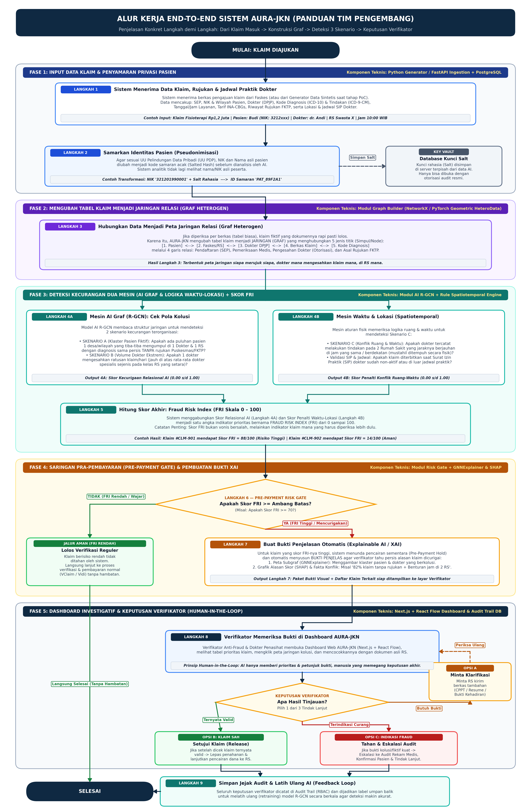

# AURA-JKN (Autonomous Relational Anti-Fraud)
**Deteksi Risiko Klaim Fiktif Berbasis Graf Heterogen dan R-GCN**  
*Lapisan pendukung keputusan investigatif untuk memprioritaskan klaim berindikasi Phantom Billing dan Repeat Billing sebelum pembayaran — BPJS Kesehatan Healthkathon 2026*

---

## Arsitektur & Struktur Proyek



Repositori ini mengimplementasikan arsitektur modular **AURA-JKN** yang terdiri dari 4 komponen utama:

```text
Healthkathon-BPJS-KESEHATAN/
├── backend/                        # Backend Service (Next.js API Routes + Prisma ORM + PostgreSQL)
│   ├── prisma/
│   │   ├── schema.prisma           # Skema tabel PostgreSQL (Facility, Doctor, Patient, Claim, RiskAssessment, HumanReview, AuditLog)
│   │   └── seed.ts                 # Seeder data klaim & hasil asesmen risiko
│   └── src/app/api/                # REST API Endpoints (/api/health, /api/claims, /api/claims/[claimId]/review)
├── frontend/                       # Frontend Dashboard Investigatif (React.js + Vite + Tailwind CSS + React Flow)
│   └── src/
│       ├── components/SubgraphViewer.tsx # Visualisasi interaktif 5 jenis simpul & 4 relasi graf (XAI)
│       └── App.tsx                 # Dashboard Pre-Payment Risk Gate & Human-in-the-Loop Verifikator
├── data/                           # Dataset kolumnar Parquet (facilities, doctors, patients, claims)
├── docs/                           # Dokumentasi aturan logika keputusan & proposal
├── AURA_JKN_hetero_graph.ipynb     # Phase 1: Generator data sintetis 3 skenario fraud & konstruksi HeteroData
├── train_rgcn.py                   # Phase 2: Pelatihan & evaluasi model PyTorch Geometric AuraJKNRGCN
├── app.py                          # Phase 3: Layanan inferensi AI R-GCN, Spatiotemporal & Subgraf NetworkX
└── docker-compose.yml              # Kontainer database PostgreSQL 16
```

---

## Panduan Setup & Menjalankan Sistem

### 1. Menjalankan Database PostgreSQL
Anda dapat menggunakan PostgreSQL lokal atau menjalankannya langsung via Docker:
```bash
docker compose up -d postgres
```

### 2. Setup Folder `backend/` (Next.js + Prisma + PostgreSQL)
```bash
cd backend
cp .env.example .env
npm install
npx prisma generate
npx prisma db push
npm run db:seed
npm run dev
```
*Layanan Backend Next.js berjalan di `http://localhost:3001`.*

### 3. Setup Folder `frontend/` (React.js + Vite + React Flow)
Buka terminal baru:
```bash
cd frontend
cp .env.example .env
npm install
npm run dev
```
*Dashboard Investigatif React.js dapat diakses di `http://localhost:5173`.*

### 4. (Opsional) Menjalankan Mesin Inferensi Python AI (`app.py`)
Jika ingin menghubungkan `backend/` langsung ke engine PyTorch Geometric secara *live*:
```bash
uvicorn app:app --host 127.0.0.1 --port 8000 --reload
```

---

## Tim Pengembang (Tim FANTASTIC — Politeknik Negeri Indramayu)
* **Faiz Jihad Al Baihaqi**
* **Ravli**
* **Lesmana Adhi Kusuma**
