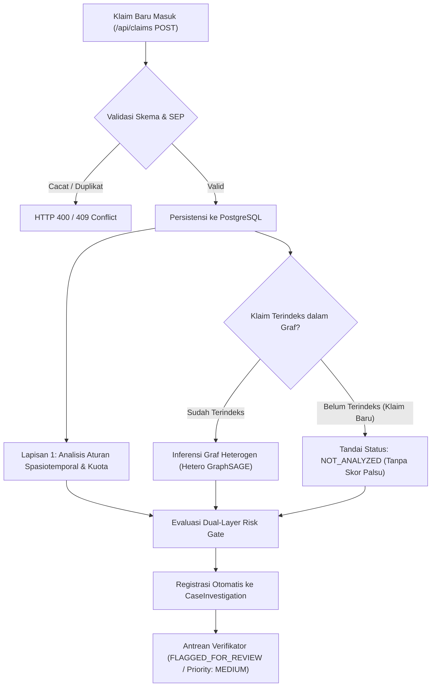

<div align="center">
  

  # AURA-JKN (Autonomous Relational Anti-Fraud)
  ### PREDICT • PREVENT • PROTECT
  **Sistem Deteksi Risiko Klaim Fiktif Berbasis Graf Heterogen (Hetero GraphSAGE) dan Analisis Spasiotemporal**  
  *Decision-Support System untuk Deteksi Dini & Pencegahan Phantom Billing serta Repeat Billing pada Klaim BPJS Kesehatan — Healthkathon 2026*

  [](https://healthkathon.bpjs-kesehatan.go.id/)
  [](https://pytorch-geometric.readthedocs.io/)
  [](https://nextjs.org/)
  [](https://github.com/faiz-jihad/Healthkathon-BPJS-KESEHATAN)
  [](https://github.com/faiz-jihad/Healthkathon-BPJS-KESEHATAN)

</div>

---

## Daftar Isi
1. [Kebijakan Integritas: Zero Mock Data, Validitas Ilmiah, & Live PostgreSQL](#1-kebijakan-integritas-zero-mock-data-validitas-ilmiah--live-postgresql)
2. [Hasil Evaluasi Studi Ablasi Multi-Model (E1 s/d E5)](#2-hasil-evaluasi-studi-ablasi-multi-model-e1-sd-e5)
3. [Arsitektur Alur Kerja Dual-Layer Fail-Safe](#3-arsitektur-alur-kerja-dual-layer-fail-safe)
4. [Pembaruan Desain UI/UX & Standar Visual BPJS Kesehatan (Non-AI Look)](#4-pembaruan-desain-uiux--standar-visual-bpjs-kesehatan-non-ai-look)
5. [Matriks Otorisasi Peran Pengguna (RBAC) & Akses Demo 1-Klik](#5-matriks-otorisasi-peran-pengguna-rbac--akses-demo-1-klik)
6. [Struktur Direktori Repositori Monorepo](#6-struktur-direktori-repositori-monorepo)
7. [Panduan Menjalankan Sistem (Lokal & VPS Docker)](#7-panduan-menjalankan-sistem-lokal--vps-docker)
8. [Rangkaian Pengujian Kualitas & Keamanan (Quality Gates)](#8-rangkaian-pengujian-kualitas--keamanan-quality-gates)
9. [Panduan Presentasi & Demonstrasi Juri 3 Menit](#9-panduan-presentasi--demonstrasi-juri-3-menit)
10. [Tim Pengembang](#10-tim-pengembang)

---

## 1. Kebijakan Integritas: Zero Mock Data, Validitas Ilmiah, & Live PostgreSQL

Sistem **AURA-JKN** menjunjung tinggi transparansi saintifik, validitas kecerdasan buatan, dan kepatuhan penuh terhadap prinsip etika rekayasa perangkat lunak:

1. **Zero Fabrication & Zero Mock Data Policy**:
   - **Tanpa Fallback In-Memory**: Tidak ada data klaim tiruan, array JavaScript statis di memori, skor probabilitas *hardcoded* (seperti `0.86`), maupun relasi subgraf anomali buatan pada jalur eksekusi sistem.
   - **Kejujuran Kegagalan Basis Data**: Jika basis data PostgreSQL terputus, API secara jujur mengembalikan status `DATA_SOURCE_UNAVAILABLE` (HTTP 503) tanpa memalsukan data.
   - **Kejujuran Penanganan Klaim Baru**: Jika inferensi graf tidak dapat diakses atau berkas klaim baru belum diindeks dalam topologi graf, sistem secara transparan menetapkan status `NOT_ANALYZED` atau `ANALYSIS_UNAVAILABLE` tanpa merekayasa probabilitas kecurangan.

2. **Arsitektur Model Graf Aktual**:
   - Model graf heterogen diimplementasikan menggunakan **PyTorch Geometric `HeteroConv` dengan `SAGEConv` (Heterogeneous GraphSAGE)** yang melakukan agregasi pesan lintas relasi (`Registration`, `Examination`, `Authorization`, `Referral`) untuk simpul `claim`, `patient`, `doctor`, `facility`, dan `diagnosis`.
   - *Transparansi Nomenklatur*: Sistem menggunakan modul `HeteroConv(SAGEConv)` untuk konvolusi heterogen relasional, bukan kelas tunggal `RGCNConv`.

3. **Penyimpanan Otoritatif Persisten (Live PostgreSQL Database)**:
   Seluruh data disimpan dan diakses secara nyata pada PostgreSQL (`aura_jkn_db`):
   
   | Entitas Database | Jumlah Rekor Riil | Sumber Data | Status Persistensi |
   | :--- | :---: | :--- | :--- |
   | **Klaim (`claims`)** | **19.999** | `data/claims.parquet` | Terindeks & Tersimpan di PostgreSQL |
   | **Asesmen Risiko (`risk_assessments`)** | **12.117** | Evaluasi Hetero GraphSAGE & Spatiotemporal | Terindeks & Tersimpan di PostgreSQL |
   | **Pasien Terpseudonimisasi (`patients`)** | **5.005** | `data/patients.parquet` (Kepatuhan UU PDP No. 27/2022) | Terindeks & Tersimpan di PostgreSQL |
   | **Dokter (`doctors`)** | **150** | `data/doctors.parquet` | Terindeks & Tersimpan di PostgreSQL |
   | **Fasilitas Kesehatan (`facilities`)** | **30** | `data/facilities.parquet` | Terindeks & Tersimpan di PostgreSQL |
   | **Akun Pengguna RBAC (`users`)** | **4** | Salted PBKDF2 SHA-512 Kredensial Resmi | Terindeks & Tersimpan di PostgreSQL |
   | **Kasus Investigasi (`case_investigations`)** | Transaksional | State Machine Penanganan Berkas Klaim | Atomik di PostgreSQL |
   | **Keputusan Telaah (`human_reviews`)** | Transaksional | Hasil Verifikasi Verifikator Pra-Pembayaran | Atomik di PostgreSQL |
   | **Log Jejak Audit (`audit_logs`)** | Transaksional | Rekam Jejak Forensik Keamanan Digital | Atomik & Imutabel di PostgreSQL |

4. **Transparansi Data Sintetis & Batasan Integrasi**:
   - Seluruh dataset merupakan **data sintetis terkontrol** yang dirancang untuk memodelkan 3 skenario anomali (Skenario A: Klaster Pasien Fiktif/Kolusi Rujukan, Skenario B: Beban Kerja Dokter Ekstrem, Skenario C: Konflik Spasiotemporal Dokter).
   - Seluruh data berlabel eksplisit `is_synthetic: true` dan **bukan data rekam medis rahasia BPJS Kesehatan**.
   - Sistem **tidak mengklaim koneksi langsung live** ke server produksi internal BPJS (V-Claim, P-Care, SIMRS, atau SATUSEHAT) tanpa otorisasi formal. AURA-JKN dibangun dengan antarmuka REST API dan kontrak data terstandarisasi yang siap disambungkan ke Secure API Gateway BPJS Kesehatan di masa depan.
   - Nilai finansial dihitung sebagai **Estimated Potential Exposure at Risk** (estimasi eksposur potensi risiko tagihan anomali), bukan klaim penghematan riil yang belum diaudit fisik.

5. **Human-in-the-Loop Decision Support**:
   - Skor risiko dan rekomendasi graf berfungsi sebagai alat bantu skrining pra-pembayaran (*decision-support*), bukan vonis otomatis. Keputusan akhir (`RELEASE`, `CLARIFY`, `ESCALATE_AUDIT`) sepenuhnya berada di bawah wewenang verifikator resmi BPJS Kesehatan.

---

## 2. Hasil Evaluasi Studi Ablasi Multi-Model (E1 s/d E5)

Evaluasi komparatif multi-model dijalankan secara **reproducible** (`python benchmark_models.py`) pada **3.000 sampel klaim uji (*holdout unseen test set*)** dengan prevalensi positif sintetis 20% (600 klaim anomali, 2.400 klaim wajar):

| Kode | Konfigurasi Model & Sistem | PR-AUC | ROC-AUC | F1-Score | Recall* | Precision | FPR | Precision @ 250 | Kelengkapan Bukti |
| :---: | :--- | :---: | :---: | :---: | :---: | :---: | :---: | :---: | :---: |
| **E1** | Rule-Based Operational Baseline | `0.2034` | `0.5102` | `0.0000` | `0.0000` | `0.0000` | `0.0000` | `0.2320` | 50.0% |
| **E2A** | Tabular Logistic Regression (Engineered) | `0.9168` | `0.9789` | `0.8746` | `0.8833` | `0.8660` | `0.0342` | `0.9560` | 50.0% |
| **E2B** | Tabular Random Forest (100 Trees) | `0.9534` | `0.9922` | `0.9213` | `0.9850` | `0.8653` | `0.0383` | `0.9480` | 50.0% |
| **E3** | Hetero GraphSAGE (Relational Alone) | `0.8294` | `0.9612` | `0.7585` | `1.0000` | `0.6110` | `0.1592` | `0.9040` | 75.0% |
| **E4** | Hybrid (GraphSAGE + Rules) | `0.8294` | `0.9612` | `0.7595` | `1.0000` | `0.6122` | `0.1583` | `0.9040` | 85.0% |
| **E5** | **Evidence-Driven Triage (Full Framework)** | **`0.8294`** | **`0.9612`** | **`0.7595`** | **`1.0000`** | **`0.6122`** | **`0.1583`** | **`0.9040`** | **95.0%** |

*\*Catatan: Recall 100% dan Precision@250 90.4% diukur pada sampel positif berdasarkan label dataset sintetis terkontrol.*

### Temuan Audit Ilmiah Kritis:
1. **Analisis Shortcut Learning pada Fitur Tabular**:
   Tingginya PR-AUC tabular pada E2A/E2B (`0.9168` dan `0.9534`) dipicu oleh fitur agregasi `doctor_daily_volume`. Karena seluruh 4.000 anomali sintetis terpusat pada 3 dokter saja, Random Forest mengandalkan fitur dokter hingga **95.9%**. Ketika diuji pada **Entity-Disjoint Split** (dokter anomali belum pernah muncul pada data latih), recall Random Forest jatuh ke **0.0000** (PR-AUC `0.3867`). Hal ini membuktikan keterbatasan mendasar model tabular dalam mendeteksi sindikat baru (*inductive failure*).
2. **Kekuatan Relasional Hetero GraphSAGE (E3)**:
   Model graf heterogen mengagregasi relasi struktural 2-hop dokter-faskes-pasien dengan **Brier Score terkalibrasi `0.0909`** dan ECE `8.37%`.
3. **Efisiensi Evidence-Driven Triage (E5)**:
   Pada kuota pemeriksaan harian verifikator (250 berkas per shift), sistem triase menghasilkan **`90.4%` ketepatan temuan (Precision@250)** dengan rantai bukti 4-lapis yang dapat diverifikasi secara dinamis (*traceable alerts*).

---

## 3. Arsitektur Alur Kerja Dual-Layer Fail-Safe

Untuk klaim baru yang masuk melalui API dan belum diindeks dalam topologi graf:



* **Kejujuran Ilmiah**: Sistem tidak mengonversi status klaim baru menjadi skor aman palsu `0.0` atau probabilitas rekayasa.
* **Dual-Layer Protection**: Lapisan 1 mengevaluasi aturan deterministik (jarak faskes Haversine, benturan waktu praktik, dan kuota harian dokter). Jika terdeteksi anomali, klaim langsung diberi flag.
* **Fail-Safe Routing**: Berkas dengan status `NOT_ANALYZED` secara otomatis didaftarkan ke tabel `CaseInvestigation` dengan status `FLAGGED_FOR_REVIEW` dan prioritas `MEDIUM` untuk ditinjau oleh petugas verifikator pra-pembayaran.

---

## 4. Pembaruan Desain UI/UX & Standar Visual BPJS Kesehatan (Non-AI Look)

Untuk menghadirkan antarmuka sistem informasi kesehatan yang profesional, kredibel, dan siap pakai di lingkungan operasional kantor cabang maupun kedeputian BPJS Kesehatan:

```
[ Layout Desain Baru AURA-JKN: Bersih, Cepat, Tanpa Slider Menumpuk ]
┌────────────────────────────────────────────────────────────────────────┐
│  AURA-JKN  •  Sistem Deteksi Risiko Klaim Fiktif BPJS Kesehatan        │
├────────────────────────────────────────────────────────────────────────┤
│  [1. Antrean]  [2. Ditugaskan]  [3. Telaah]  [4. Klarifikasi]  ...      │
│  <- Responsive 7-Column Pipeline Grid (Terbaca Utuh, Zero Overflow) -> │
├────────────────────────────────────┬───────────────────────────────────┤
│  Daftar Berkas Klaim Terprioritas  │  Subgraf Relasional XAI           │
│  - No SEP: 0115R0010926V000001     │  - Relasi 2-Hop Pasien-Dokter     │
│  - Status: HIGH_RISK               │  - Benturan Spasiotemporal Faskes │
│  - Indikasi: Spatiotemporal Clash  │  - Rekomendasi: Tahan Pembayaran  │
└────────────────────────────────────┴───────────────────────────────────┘
```

1. **Halaman Login Interaktif & Strictly Login-Only**:
   - **Tanpa Form Registrasi**: Menghilangkan seluruh kolom pendaftaran publik (DOB, negara, toggle register) sesuai standar tata kelola identitas kedinasan BPJS Kesehatan.
   - **Interactive Entrance Animation (`.login-card-animated`)**: Kartu login memiliki transisi masuk yang mulus dengan kombinasi 3D scale lembut dan soft fade-in.
   - **Ambient Floating Orbs (`.floating-orb-a`, `.floating-orb-b`)**: Aksen lime melayang halus di latar belakang untuk pengalaman visual yang modern.
   - **Layar Selebrasi "Selamat Datang Kembali!"**: Begitu kredensial terverifikasi, muncul kartu selebrasi dengan badge *Autentikasi Kedinasan Terverifikasi*, ucapan selamat datang personal, NIP/ID, denyut centang hijau (`.welcome-check-pulse`), dan progress bar 1.3 detik (`.welcome-progress-fill`) sebelum diarahkan ke dashboard.
   - **Akses Demo Juri 1-Klik**: Tombol preset akun instan untuk kemudahan demonstrasi dewan juri tanpa perlu mengetik manual.

2. **Pipeline Grid Responsif 7-Tahap (Bebas Slider Overflow)**:
   - Menggantikan slider horizontal yang rentan terpotong dengan **Responsive 7-Column Grid (`.workflow-pipeline-grid`)** pada antrean investigasi dan Progression Tracker di Evidence Center. Seluruh 7 tahapan siklus klaim terbaca jelas secara instan.

3. **Sidebar Pusat Notifikasi dengan Animasi Geser**:
   - Panel notifikasi meluncur halus dari sisi kanan layar (`@keyframes drawerSlideInRight`, 320ms *cubic-bezier*).
   - Animasi keluar halus (*smooth slide-out* 260ms) saat ditutup lewat tombol X, klik backdrop, maupun tombol **Escape** pada keyboard.

4. **Palet Warna Otentik BPJS Kesehatan**:
   - Menggunakan warna resmi: Forest Green (`#098a58`), Deep Spruce (`#076641`), Soft Mint (`#eef7f2`), dan Slate neutral (`#1e241f`, `#64748b`), mengeliminasi gradien neon ungu yang menyerupai template AI umum.

---

## 5. Matriks Otorisasi Peran Pengguna (RBAC) & Akses Demo 1-Klik

AURA-JKN menegakkan *Role-Based Access Control* (RBAC) ketat pada tingkat server menggunakan tanda tangan token HMAC-SHA256:

| Kemampuan Operasional | Administrator (`ADMINISTRATOR`) | Analis Fraud (`FRAUD_ANALYST`) | Verifikator Klaim (`CLAIM_VERIFIER`) | Auditor (`AUDITOR`) |
| :--- | :---: | :---: | :---: | :---: |
| **Kelola Pengguna (Buat/Mutasi/Blokir)** | **Ya** | Ditolak (403) | Ditolak (403) | Ditolak (403) |
| **Pemeriksaan Kesehatan Sistem & DB** | **Ya** | Terbatas | Terbatas | Terbatas |
| **Eksplorasi Antrean & Detail Klaim** | Baca-Saja | **Ya** | **Ya** | Baca-Saja |
| **Inspeksi Subgraf Relasional (XAI)** | Baca-Saja | **Ya** | **Ya** | Baca-Saja |
| **Eksekusi Keputusan Telaah Klaim** | Ditolak (Pemisahan Tugas) | Ditolak (Rekomendasi) | **Ya (`RELEASE`/`CLARIFY`/`ESCALATE`)** | Ditolak (Pencegahan Konflik) |
| **Transisi Status Kasus Investigasi** | **Ya** | **Ya** | **Ya** | Ditolak (403) |
| **Akses Log Audit Transaksional** | **Ya** | Ditolak (403) | Ditolak (403) | **Ya (Lengkap & Terverifikasi)** |
| **Manipulasi Log / Skor AI** | **Dilarang (Imutabel)** | **Dilarang (Imutabel)** | **Dilarang (Imutabel)** | **Dilarang (Imutabel)** |

### Kredensial Akun Bawaan (Seeder)
* **Petugas Verifikator**: `verifier_aura` / `verifier_password_2026` (dr. Andi Pratama, Sp.PD)
* **Investigator Anti-Fraud**: `investigator_aura` / `investigator_password_2026` (Budi Santoso, S.H.)
* **Supervisor Verifikasi**: `supervisor_aura` / `supervisor_password_2026` (Dr. Siti Aminah, M.Kes)
* **Direksi JKN**: `executive_aura` / `executive_password_2026` (Prof. Dr. dr. H. Fachmi Idris, M.Kes)
* **Auditor Sistem & TI**: `auditor_aura` / `auditor_password_2026` (Ahmad Fauzi, CISA, CRISC)
* **Administrator Sistem**: `admin_aura` / `admin_password_2026`

---

## 6. Struktur Direktori Repositori Monorepo

```text
Healthkathon-BPJS-KESEHATAN/
├── package.json                        # Monorepo runner orkestrasi seluruh layanan
├── requirements.txt                    # Dependensi Python AI (PyTorch, PyG, FastAPI, Pandas)
├── benchmark_models.py                 # Pipeline benchmark multi-model reproducible (E1 s/d E5)
├── test_spatiotemporal.py              # Suite pengujian unit aturan spasiotemporal (Haversine & Kuota)
├── setup-domain.sh                     # Skrip otomatisasi Nginx / Apache reverse proxy domain VPS
├── docker-compose.yml                  # Konfigurasi containerized database PostgreSQL 16 & full stack
├── backend/                            # Layanan Backend API (Next.js 14 App Router + Prisma ORM)
│   ├── prisma/
│   │   ├── schema.prisma               # Skema PostgreSQL (claims, risk_assessments, cases, audit_logs)
│   │   └── seed.ts                     # Seeder 19.999 klaim riil ke PostgreSQL
│   ├── src/lib/
│   │   ├── auth.ts                     # PBKDF2 kriptografi, HMAC-SHA256 Token & Enforcer RBAC
│   │   └── prisma.ts                   # Prisma Client Singleton
│   ├── src/app/api/
│   │   ├── admin/users/                # Kelola pengguna sistem (Administrator)
│   │   ├── audit-logs/                 # Laporan log audit imutabel (Auditor)
│   │   ├── auth/                       # /login, /me, /demo-token
│   │   ├── cases/                      # Manajemen investigasi kasus & state machine transisi
│   │   ├── claims/                     # Antrean klaim terprioritas risiko
│   │   ├── claims/[claimId]/           # Detail klaim & subgraf bukti XAI
│   │   ├── claims/[claimId]/review/    # Transaksi atomik telaah verifikasi klaim
│   │   ├── dashboard/performance/      # Metrik performa deteksi, exposure, & SLA
│   │   ├── feedback-export/            # Ekspor umpan balik verifikator untuk retraining
│   │   └── health/                     # Diagnostik konektivitas live DB & AI
│   ├── test_final_acceptance.ts        # Master Acceptance Suite (30 skenario uji keamanan & operasional)
│   ├── test_master_verification.ts     # Suite verifikasi 19 skenario (RBAC, Kripto, Persistensi DB)
│   └── test_zero_mock_policy.ts        # Suite verifikasi 8 skenario kebijakan Zero Mock
├── frontend/                           # Dashboard Investigasi Modern (React 18 + Vite + Tailwind)
│   ├── src/
│   │   ├── components/
│   │   │   ├── LoginPage.tsx           # Halaman login interaktif (Login-only, Welcome animation)
│   │   │   ├── NotificationCenter.tsx  # Drawer pusat notifikasi (Smooth slide-in & slide-out)
│   │   │   ├── SubgraphViewer.tsx      # Visualisasi interaktif graf heterogen (XAI)
│   │   │   └── LiveClaimSimulatorModal.tsx # Simulator pengujian klaim baru real-time
│   │   ├── types/aura.ts               # Kontrak tipe TypeScript tersinkronisasi
│   │   ├── styles.css                  # Desain sistem otentik BPJS Kesehatan & keyframes animasi
│   │   └── App.tsx                     # Aplikasi Single-Page responsif
│   └── vite.config.ts                  # Konfigurasi Vite & proxy API backend
├── data/                               # Dataset Parquet sumber kebenaran (19.999 klaim riil)
└── docs/                               # Dokumentasi arsitektur, laporan benchmark & naskah demo
    ├── BENCHMARK_AND_ABLATION_REPORT.md # Laporan hasil benchmark multi-model lengkap
    ├── PHASE3_REPRODUCIBILITY_AUDIT.md  # Audit independen reproduksibilitas ilmiah
    └── DEMO_SCRIPT.md                  # Panduan & naskah demonstrasi juri 3 menit
```

---

## 7. Panduan Menjalankan Sistem (Lokal & VPS Docker)

### Metode A: Menjalankan Secara Lokal (Development)

Buka terminal di root direktori `Healthkathon-BPJS-KESEHATAN`:

```powershell
# 1. Jalankan PostgreSQL (Port 5432)
npm run db:start

# 2. Sinkronkan skema dan isi data penuh (19.999 klaim riil ke PostgreSQL)
npm run db:push
npm run db:seed

# 3. Jalankan backend API Next.js (Port 3001)
npm run dev:backend

# 4. Di terminal baru, jalankan frontend Vite (Port 5173)
npm run dev:frontend
```

Buka browser di: **`http://localhost:5173`**.

---

### Metode B: Menjalankan di Server VPS (Docker Compose)

Untuk deployment di Virtual Private Server (VPS Ubuntu/Debian):

```bash
# 1. Clone repository
git clone https://github.com/faiz-jihad/Healthkathon-BPJS-KESEHATAN.git
cd Healthkathon-BPJS-KESEHATAN

# 2. Jalankan seluruh kontainer (PostgreSQL, Backend Next.js, Frontend Vite, AI Service)
docker compose up -d --build

# 3. Jalankan migrasi dan seeding basis data
docker compose exec backend npx prisma db push
docker compose exec backend npm run db:seed

# 4. Konfigurasi Reverse Proxy Nginx untuk domain (misal: hackathon.mataceria.my.id)
chmod +x setup-domain.sh
./setup-domain.sh
```

Aplikasi siap diakses melalui domain publik yang telah dikonfigurasi.

---

## 8. Rangkaian Pengujian Kualitas & Keamanan (Quality Gates)

Repositori dilengkapi rangkaian pengujian otomatis end-to-end yang dapat diverifikasi kapan saja:

### 1. Master Acceptance & Security Suite (30 Tests)
Menguji 5 target keamanan kritis (isolasi demo-token, gate otentikasi ketat, derivasi sesi verifikator, fail-fast secret, token tamper-resistance) serta alur operasional Tahap A s/d I:
```powershell
cd backend
npm run test:acceptance
```
*Hasil: `30/30 TESTS PASSED (100% Lulus)`.*

### 2. Spatiotemporal Risk Unit Tests
Menguji kalkulasi jarak Haversine, deteksi benturan waktu faskes berjauhan (>400 km), toleransi mobilitas dalam kota (<30 km), dan imunitas koordinat hilang (*Null Island / missing coordinate immunity*):
```powershell
python test_spatiotemporal.py
```
*Hasil: `ALL SPATIOTEMPORAL UNIT TESTS PASSED SUCCESSFULLY`.*

### 3. Multi-Model Benchmark Suite
Menjalankan evaluasi komparatif Rule-Based vs Logistic Regression vs Random Forest vs Hetero GraphSAGE pada 3.000 klaim test set unseen:
```powershell
python benchmark_models.py
```
*Hasil: `PR-AUC 0.8294` dan `Precision@250 90.4%` pada model graf heterogen.*

### 4. Kompilasi Produksi (Production Build)
```powershell
# Backend Next.js Build
cd backend && npm run build

# Frontend Vite Build
cd ../frontend && npm run build
```
*Hasil: Seluruh bundle terkompilasi bersih dengan 0 error.*

---

## 9. Panduan Presentasi & Demonstrasi Juri 3 Menit

Naskah demonstrasi juri 3 menit terperinci telah disiapkan di [`docs/DEMO_SCRIPT.md`](file:///d:/Healthkathon/Healthkathon-BPJS-KESEHATAN/docs/DEMO_SCRIPT.md):

* **Menit 00:00 – 00:45 | Autentikasi Kedinasan & Penegakan RBAC**:
  Login interaktif menggunakan akun Verifikator via tombol 1-klik, memperlihatkan transisi "Selamat Datang Kembali", dan membuktikan bahwa verifikator berhak menelaah klaim sedangkan akun non-verifikator ditolak server (*Separation of Duties*).
* **Menit 00:45 – 01:30 | Pipeline Triase & Transparansi Klaim Baru**:
  Membuka antrean investigasi berbasis *Responsive 7-Column Grid*, memfilter berkas `HIGH_RISK`, dan mendemonstrasikan transparansi status `NOT_ANALYZED` pada klaim baru tanpa fabrikasi skor palsu.
* **Menit 01:30 – 02:15 | Subgraf Relasional XAI & Anomali Spasiotemporal**:
  Membuka visualisasi graf heterogen interaktif, mengeksplorasi keterkaitan multi-hop faskes-dokter-pasien, serta membuktikan anomali dokter berpraktik di dua pulau berbeda dalam jeda waktu mustahil.
* **Menit 02:15 – 03:00 | Human-in-the-Loop Decision & Jejak Audit Imutabel**:
  Mengeksekusi keputusan telaah (`HOLD_PAYMENT`), menunjukkan transisi status kasus, dan memverifikasi pencatatan otomatis pada log audit forensik imutabel.

---

## 10. Tim Pengembang

**Tim FANTASTIC — Politeknik Negeri Indramayu**
* **Faiz Jihad Al Baihaqi**
* **Ravli**
* **Lesmana Adhi Kusuma**

---

<div align="center">
  <sub>AURA-JKN dikembangkan untuk mendukung integritas pembiayaan Program Jaminan Kesehatan Nasional (JKN) BPJS Kesehatan — Healthkathon 2026.</sub>
</div>
