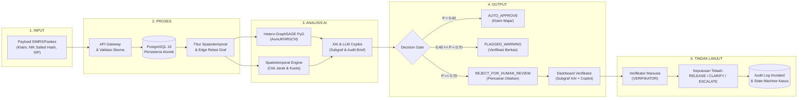

# SLIDE 4: ALUR PROSES APLIKASI AURA-JKN (REVISI FINAL TERVERIFIKASI)
**Healthkathon BPJS Kesehatan 2026 — Tim FANTASTIC**  
**Dokumen Desain & Validasi Arsitektur Alur Sistem End-to-End**  
**Hasil Audit Forensik**: *Strict Zero-Mock, Zero-Fabrication, Codebase-Grounded*

---

## 🖥️ 1. JUDUL SLIDE
> **4 Alur Proses Aplikasi**  
> *Arsitektur Penapisan Risiko Pra-Pembayaran Berbasis Graph AI, Spatiotemporal, dan Human-in-the-Loop*

---

## 🔄 2. KONTEN FINAL 5 TAHAPAN PROSES (SIAP SALIN KE PPT)

Dirancang ringkas (maksimal 2–3 poin padat per kotak) agar pas dan rapi pada template slide:

### **1. Input**
* **Pengajuan Klaim Digital SIMRS/Faskes**: Berkas masuk via API Gateway memuat ID Klaim, tarif INA-CBGs, diagnosa ICD-10/ICD-9, lama rawat, dan waktu pelayanan.
* **Identitas Entitas Terotentikasi**: Atribut dokter (nomor SIP), faskes (FKTP/FKRTL & koordinat Dati2), dan pasien terpseudonimisasi (*one-way salted hashing* SHA-256 sesuai UU PDP).
* **Validasi Skema Awal**: Validasi tipe data ketat via Pydantic & Zod; payload tidak sah atau tanpa token HMAC langsung ditolak (HTTP 400/401).

### **2. Proses**
* **Persistensi Transaksional Atomik**: Entitas klaim, dokter, faskes, dan pasien disimpan permanen ke PostgreSQL via `prisma.$transaction` sebelum evaluasi AI.
* **Ekstraksi Fitur Spasiotemporal**: Menghitung kuota volume pelayanan harian dokter dan jarak tempuh fisik faskes menggunakan *Formula Haversine*.
* **Konstruksi Topologi Graf**: Memetakan simpul klaim ke dalam topologi graf 5 entitas; klaim faskes baru yang belum terindeks diberi status jujur `NOT_ANALYZED`.

### **3. Analisis AI**
* **Inferensi Hetero-GraphSAGE (`HeteroConv` + `SAGEConv`)**: Model `AuraJKNRGCN` mengagregasi pesan 2-hop lintas 10 relasi untuk memetakan anomali sindikat rujukan sirkular dan klinik boneka.
* **Evaluasi Fisika Spasiotemporal**: Mendeteksi anomali mustahil (dokter praktik di faskes beda kota >400 km di hari yang sama atau volume $\ge 80$ pasien/hari).
* **XAI & Generative AI Copilot**: NetworkX mengekstrak subgraf bukti, sementara LLM Copilot merangkum *Executive Audit Brief* berbasis *Strict Context Isolation*.

### **4. Output**
* **Triase Risiko & Gerbang Pra-Bayar**: Klasifikasi otomatis ke dalam 3 level gerbang: `AUTO_APPROVE` ($P < 0.40$), `FLAGGED_WARNING` ($0.40 \le P < 0.70$), dan `REJECT_FOR_HUMAN_REVIEW` ($P \ge 0.70$).
* **Evidence Center Interaktif**: Visualisasi subgraf jaringan relasional (simpul anomali berkode warna) dan narasi ringkasan fakta klinis.
* **Interactive AI Audit Copilot**: Dialog interaktif bagi verifikator untuk mengonfirmasi kejanggalan berkas secara instan via *quick prompts*.

### **5. Tindak Lanjut**
* **Penguncian Status Pra-Bayar**: Klaim berisiko tinggi otomatis dikunci di gerbang pra-bayar dan dialihkan ke antrean investigasi (`CaseInvestigation` status `FLAGGED_FOR_REVIEW`).
* **Keputusan Verifikator Resmi (Human-in-the-Loop)**: Verifikator berwenang tunggal mengeksekusi tindakan resmi: `RELEASE` (Cairkan), `CLARIFY` (Minta Rekam Medis), atau `ESCALATE_AUDIT` (Tolak/Audit Lanjut).
* **Pencatatan Audit Trail Imutabel**: Setiap telaah klinis dan riwayat pertanyaan Copilot dicatat permanen berstempel waktu di tabel `audit_logs`.

---

## 📦 3. KONTEN FINAL 3 KOTAK PENDUKUNG (SIAP SALIN KE PPT)

### **PENGGUNA / AKTOR**
* **Verifikator Klaim (`VERIFIKATOR` / `CLAIM_VERIFIER`)**: Berwenang klinis tunggal mengeksekusi keputusan telaah pra-pembayaran (`RELEASE` / `CLARIFY` / `ESCALATE_AUDIT`).
* **Investigator Anti-Fraud (`INVESTIGATOR` / `FRAUD_ANALYST`)**: Menelusuri klaster sindikat multi-faskes di Evidence Center dan mengelola transisi siklus investigasi kasus.
* **Auditor Sistem & Data Analyst (`DATA_ANALYST` / `AUDITOR`)**: Memantau metrik model, kepatuhan SLA, dan memeriksa log audit forensik imutabel (Akses *Read-Only*).
* **Administrator & Supervisor (`ADMINISTRATOR` / `SUPERVISOR`)**: Mengelola akun pengguna, penegakan RBAC, persetujuan eskalasi kasus, dan pemantauan kesehatan server.

### **DATA YANG DIPAKAI**
* **Format & Skema Data**: Dataset analitik terkalibrasi memodelkan skema resmi Data Sampel BPJS Kesehatan (19.999 klaim, 5.000 pasien, 150 dokter, 30 faskes, 10 diagnosa ICD-10).
* **Fitur Spasial & Relasional**: Data faskes mencakup koordinat centroid Dati2 (Kabupaten/Kota), master jam praktik dokter, dan 10 jenis relasi pelayanan (*examined_by*, *authorized*, *referred_to*, dll).
* **Etika & Kepatuhan Regulasi**: Menggunakan data sintetis terkontrol demi kepatuhan **UU Perlindungan Data Pribadi No. 27/2022**; identitas pasien dilindungi *salted one-way hashing* SHA-256.

### **TEKNOLOGI**
* **Frontend**: React 18, TypeScript, Tailwind CSS, dan `@xyflow/react` untuk visualisasi topologi subgraf interaktif di peramban.
* **Backend & Basis Data**: Next.js 14 App Router, Prisma ORM, dan PostgreSQL 16 untuk persistensi transaksional atomik dan kontrol akses berbasis peran (RBAC HMAC-SHA256).
* **AI & XAI Engine**: Python 3.13, FastAPI, PyTorch Geometric (`HeteroConv` + `SAGEConv` — `AuraJKNRGCN`), NetworkX (subgraf bukti), dan Formula Haversine (jarak spasial).
* **Generative AI Copilot**: Llama-3.3-70B via GroqCloud API dan NVIDIA NIM API dengan *4-tier fail-safe router* otomatis ke *Local Factual Rule Engine* untuk menjamin ketersediaan tinggi.

---

## 📊 4. DIAGRAM ALUR PROSES APLIKASI (MERMAID)

---

## 📁 5. REFERENSI BUKTI SOURCE CODE, ENDPOINT, DAN DATABASE

| Tahap Alur | Komponen / Endpoint | File Sumber & Fungsi | Model / Tabel Database |
| :--- | :--- | :--- | :--- |
| **1. Input** | `POST /api/claims` `POST /api/v1/predict-claim` | [`backend/src/app/api/claims/route.ts#L614`](file:///d:/Healthkathon/Healthkathon-BPJS-KESEHATAN/backend/src/app/api/claims/route.ts#L614) [`app.py#L905`](file:///d:/Healthkathon/Healthkathon-BPJS-KESEHATAN/app.py#L905) (`predict_claim`) | Tabel `claims`, `patients`, `doctors`, `facilities` |
| **2. Proses** | `prisma.$transaction` `calculate_haversine_distance` | [`backend/src/app/api/claims/route.ts#L761`](file:///d:/Healthkathon/Healthkathon-BPJS-KESEHATAN/backend/src/app/api/claims/route.ts#L761) [`src/services/spatiotemporal.py#L32`](file:///d:/Healthkathon/Healthkathon-BPJS-KESEHATAN/src/services/spatiotemporal.py#L32) | Tabel `facilities` (lat/lon), `claims` |
| **3. Analisis AI** | `AuraJKNRGCN` (Hetero-GraphSAGE) `POST /api/v1/claims/{id}/chat` | [`src/models/rgcn.py#L40-L105`](file:///d:/Healthkathon/Healthkathon-BPJS-KESEHATAN/src/models/rgcn.py#L40-L105) [`src/services/llm_service.py#L120`](file:///d:/Healthkathon/Healthkathon-BPJS-KESEHATAN/src/services/llm_service.py#L120) | Bobot `models/aura_jkn_rgcn_model.pt` Graf `aura_jkn_hetero_graph.pt` |
| **4. Output** | `GET /api/claims` `GET /api/claims/[claimId]` | [`backend/src/app/api/claims/[claimId]/route.ts#L25`](file:///d:/Healthkathon/Healthkathon-BPJS-KESEHATAN/backend/src/app/api/claims/%5BclaimId%5D/route.ts#L25) [`frontend/src/components/SubgraphViewer.tsx#L45`](file:///d:/Healthkathon/Healthkathon-BPJS-KESEHATAN/frontend/src/components/SubgraphViewer.tsx#L45) | Tabel `risk_assessments` (Field `fraud_probability`, `pre_payment_gate`, `subgraph_evidence`) |
| **5. Tindak Lanjut**| `POST /api/claims/[id]/review` `POST /api/cases/[id]` | [`backend/src/app/api/claims/[claimId]/review/route.ts#L29`](file:///d:/Healthkathon/Healthkathon-BPJS-KESEHATAN/backend/src/app/api/claims/%5BclaimId%5D/review/route.ts#L29) [`frontend/src/components/ControlledFeedbackPanel.tsx#L85`](file:///d:/Healthkathon/Healthkathon-BPJS-KESEHATAN/frontend/src/components/ControlledFeedbackPanel.tsx#L85) | Tabel `human_reviews`, `case_investigations`, `case_transitions`, `audit_logs` |

---

## 🚦 6. STATUS IMPLEMENTASI FITUR (STATUS AUDIT AKTUAL)

| Komponen / Fitur | Status Implementasi | Bukti Verifikasi Source Code |
| :--- | :---:| :--- |
| **Validasi Skema & Autentikasi HMAC** | **IMPLEMENTED** | [`backend/src/lib/auth.ts`](file:///d:/Healthkathon/Healthkathon-BPJS-KESEHATAN/backend/src/lib/auth.ts) memverifikasi Bearer Token HMAC-SHA256 & Pydantic di FastAPI. |
| **Persistensi Transaksional PostgreSQL** | **IMPLEMENTED** | Terbukti atomik via `prisma.$transaction` di [`backend/src/app/api/claims/route.ts#L761`](file:///d:/Healthkathon/Healthkathon-BPJS-KESEHATAN/backend/src/app/api/claims/route.ts#L761). |
| **Model Hetero-GraphSAGE (`HeteroConv`)** | **IMPLEMENTED** | Terbukti di [`src/models/rgcn.py#L40`](file:///d:/Healthkathon/Healthkathon-BPJS-KESEHATAN/src/models/rgcn.py#L40) menggunakan 2-layer `HeteroConv(SAGEConv)` dengan MLP head. |
| **Aturan Spasiotemporal & Kuota Harian** | **IMPLEMENTED** | Terbukti di [`src/services/spatiotemporal.py`](file:///d:/Healthkathon/Healthkathon-BPJS-KESEHATAN/src/services/spatiotemporal.py) mendeteksi jarak $>400\text{ km}$ & volume $>45$ dan $\ge 80$ klaim/hari. |
| **Ekstraksi Subgraf XAI (NetworkX ➔ UI)** | **IMPLEMENTED** | Terbukti di [`src/services/xai.py`](file:///d:/Healthkathon/Healthkathon-BPJS-KESEHATAN/src/services/xai.py) dan divisualisasikan via ReactFlow di [`SubgraphViewer.tsx`](file:///d:/Healthkathon/Healthkathon-BPJS-KESEHATAN/frontend/src/components/SubgraphViewer.tsx). |
| **LLM Executive Brief & Copilot Chat** | **IMPLEMENTED** | Terbukti di [`src/services/llm_service.py`](file:///d:/Healthkathon/Healthkathon-BPJS-KESEHATAN/src/services/llm_service.py) via GroqCloud/NVIDIA NIM dengan fallback ke rule engine lokal. |
| **Penguncian Pra-Bayar & Routing Kasus** | **IMPLEMENTED** | Terbukti di [`backend/src/app/api/claims/route.ts#L850`](file:///d:/Healthkathon/Healthkathon-BPJS-KESEHATAN/backend/src/app/api/claims/route.ts#L850) auto-create `caseInvestigation` status `FLAGGED_FOR_REVIEW`. |
| **Pemisahan Wewenang RBAC Verifikator** | **IMPLEMENTED** | Terbukti di [`backend/src/app/api/claims/[claimId]/review/route.ts#L93`](file:///d:/Healthkathon/Healthkathon-BPJS-KESEHATAN/backend/src/app/api/claims/%5BclaimId%5D/review/route.ts#L93) hanya `VERIFIKATOR` yang diizinkan (role lain 403). |
| **Integrasi Otomatis Core Banking BPJS** | **NOT IMPLEMENTED** | Di luar cakupan prototipe Healthkathon (Sistem beroperasi sebagai *Decision-Support Gate* pada database prototipe). |

---

## ⚠️ 7. CATATAN KETERBATASAN UNTUK PRESENTASI JURI

1. **Sifat Pendukung Keputusan (*Decision-Support Only*)**:
   * AI tidak mencairkan atau menolak uang secara otomatis. Sistem menahan berkas anomali di gerbang pra-bayar dan menyajikan subgraf bukti, namun vonis klinis akhir mutlak berada di tangan verifikator resmi BPJS Kesehatan (*Human-in-the-Loop*).
2. **Kepatuhan Privasi Data**:
   * Sistem dievaluasi pada 19.999 sampel data sintetis terkalibrasi yang memodelkan format Data Sampel BPJS Kesehatan untuk mematuhi **UU PDP No. 27/2022**, bukan membocorkan data riil peserta tanpa izin resmi.
3. **Keterbatasan Transduktif Graf**:
   * Untuk entitas faskes atau dokter baru yang belum terindeks dalam topologi graf offline, sistem secara transparan memberikan status `NOT_ANALYZED` dan meneruskannya ke verifikasi manual (*Zero Mock Policy*), bukan merekayasa skor probabilitas tiruan.
