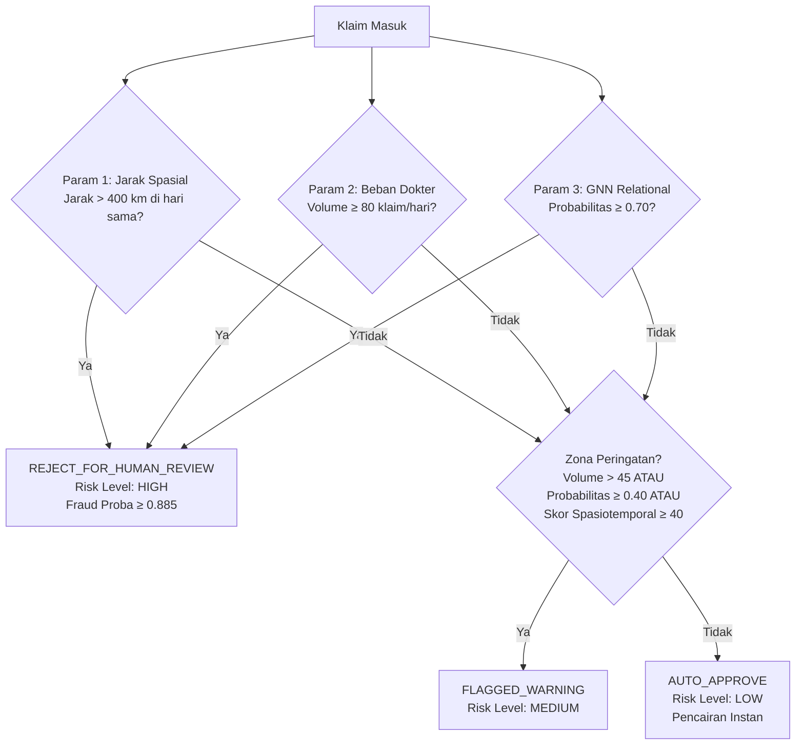

# AURA-JKN: Dokumentasi Lengkap RESTful API
**Spesifikasi Teknis API Inferensi, Pre-Payment Gate, dan Explainable AI (XAI)**  
*Healthkathon BPJS Kesehatan — Proyek AURA-JKN*

[](https://fastapi.tiangolo.com)
[](https://www.python.org/)
[](https://pytorch-geometric.readthedocs.io/)
[](https://www.postgresql.org/)
[](https://opensource.org/licenses/MIT)

---

## 📌 Daftar Isi
1. [Ikhtisar Layanan (Overview)](#1-ikhtisar-layanan-overview)
2. [Base URL & Konvensi Global](#2-base-url--konvensi-global)
3. [Ringkasan Seluruh Endpoint](#3-ringkasan-seluruh-endpoint)
4. [Detail Spesifikasi Endpoint](#4-detail-spesifikasi-endpoint)
   - [A. GET /health (Pemeriksaan Kesiapan Sistem)](#a-get-health)
   - [B. POST /api/v1/predict-claim (Evaluasi Risiko Klaim Real-Time)](#b-post-apiv1predict-claim)
   - [C. GET /api/v1/claims/{claim_id} (Audit Klaim Tersimpan)](#c-get-apiv1claimsclaim_id)
   - [D. POST /api/v1/claims/{claim_id}/chat (Interactive Copilot Chat)](#d-post-apiv1claimsclaim_idchat-interactive-copilot-chat)
   - [E. GET / (Root Info & Links)](#e-get-)
5. [Logika Penentu Keputusan (Sintesis 3 Parameter & Generative AI)](#5-logika-penentu-keputusan-sintesis-3-parameter)
6. [Struktur Subgraf XAI untuk Visualisasi Frontend](#6-struktur-subgraf-xai-untuk-visualisasi-frontend)
7. [Penanganan Error & Kode Status HTTP](#7-penanganan-error--kode-status-http)
8. [Contoh Kode Integrasi Klien (Python & JavaScript)](#8-contoh-kode-integrasi-klien)

---

## 1. Ikhtisar Layanan (Overview)

API **AURA-JKN** menyediakan antarmuka RESTful berlatensi rendah untuk verifikasi tagihan klaim rumah sakit (FKRTL/FKTP) BPJS Kesehatan secara *pre-payment* (sebelum dana klaim dicairkan). Layanan ini dirancang khusus untuk memproses data klaim berskala nasional (**1.000.000+ klaim** di 38 provinsi) dengan menggabungkan:

1. **Model Relational Graph Convolutional Network (R-GCN)** via PyTorch Geometric untuk mendeteksi kolusi dan anomali topologi multi-relasi.
2. **Mesin Verifikasi Fisik Spatiotemporal** (Haversine collision & kuota harian dokter).
3. **Penyusun Narasi Bukti Explainable AI (XAI)** dan subgraf NetworkX interaktif.
4. **Generative AI Layer (Modul 5)**: Executive Audit Brief dan Interactive Audit Copilot Chat dengan arsitektur ketahanan *Multi-Tier Fallback* (Groq &rarr; NVIDIA NIM &rarr; Local Rule Engine) bergaransi *Zero HTTP 500 Failure*.
5. **Auto-Persistence** hasil audit langsung ke database relasional PostgreSQL.

> [!NOTE]
> Sistem AURA-JKN beroperasi pada prinsip *Straight-Through Processing (STP)*: klaim berisiko rendah disetujui seketika (<50 ms), sementara klaim anomali dibekukan otomatis untuk audit mendalam tim verifikator medis BPJS Kesehatan.

---

## 2. Base URL & Konvensi Global

* **Development Base URL**: `http://localhost:8000`
* **Swagger Interactive UI**: `http://localhost:8000/docs`
* **ReDoc Documentation**: `http://localhost:8000/redoc`
* **Format Data**: Seluruh *request payload* dan *response body* menggunakan format **JSON** (`application/json`) dengan pengkodean karakter `UTF-8`.
* **CORS**: Dikonfigurasi terbuka secara default (`allow_origins=["*"]`) untuk integrasi mulus dengan dashboard frontend (React/Next.js/Vue).

---

## 3. Ringkasan Seluruh Endpoint

| Metode HTTP | Endpoint | Kategori | Ringkasan Fungsi & SLA |
| :---: | :--- | :--- | :--- |
| **`GET`** | `/health` | *System & Monitoring* | Status kesehatan memori, koneksi DB PostgreSQL, dan kapasitas data aktif nasional. |
| **`POST`** | `/api/v1/predict-claim` | *Claim Risk Assessment* | Menerima payload klaim baru, mengevaluasi 3 parameter analitik, menerbitkan putusan pre-payment gate + XAI + Audit Brief. |
| **`GET`** | `/api/v1/claims/{claim_id}` | *Claim Risk Assessment* | Mengambil data klaim dari registri master 1 juta data dan menjalankan audit instan. |
| **`POST`** | `/api/v1/claims/{claim_id}/chat` | *Audit Copilot Chat* | Asisten dialog interaktif untuk verifikator BPJS dengan konteks data klaim terisolasi (*Zero Hallucination*). |
| **`GET`** | `/` | *System & Monitoring* | Menampilkan informasi versi, status modul, dan tautan Swagger UI. |

---

## 4. Detail Spesifikasi Endpoint

### A. GET `/health`
Mengembalikan status operasional modul inferensi, ketersediaan graf heterogen, koneksi PostgreSQL, dan jumlah entitas yang terindeks dalam memori.

#### Parameter
*Tidak ada parameter permintaan.*

#### Contoh Permintaan cURL
```bash
curl -X GET "http://localhost:8000/health" -H "accept: application/json"
```

#### Struktur Response (200 OK)
```json
{
  "status": "healthy",
  "service": "AURA-JKN Phase 3 Inference API",
  "version": "1.0.0",
  "device": "cpu",
  "model_loaded": true,
  "graph_loaded": true,
  "database_connected": true,
  "num_claims_in_registry": 1000000,
  "num_facilities_in_registry": 27621,
  "num_doctors_in_registry": 78627
}
```

---

### B. POST `/api/v1/predict-claim`
Endpoint inti untuk verifikasi klaim real-time (*pre-payment verification*). Menerima rincian klaim, menghitung jarak spasial faskes perujuk, beban kerja harian dokter, probabilitas anomali graf heterogen R-GCN, serta mengembalikan putusan gate pembayaran dan grafik bukti kausalitas.

#### Request Body (`ClaimPredictionRequest`)
| Nama Field | Tipe Data | Wajib? | Contoh Nilai | Keterangan |
| :--- | :---: | :---: | :--- | :--- |
| `claim_id` | String | Ya | `"CLM_SIMULATED_2026"` | Identifier unik transaksi klaim. |
| `patient_id` | String | Ya | `"pat_demo_hash_99"` | ID peserta pseudonim. |
| `doctor_id` | String | Ya | `"DOC0040"` | ID dokter yang mengesahkan layanan medis. |
| `facility_id` | String | Ya | `"FAC0013"` | ID fasilitas kesehatan tempat klaim diajukan. |
| `icd10_code` | String | Ya | `"K29"` | Kode diagnosa primer penyakit (ICD-10). |
| `service_date` | String | Ya | `"2024-03-13"` | Tanggal pelayanan format `YYYY-MM-DD`. |
| `service_time` | String | Ya | `"11:45:00"` | Waktu pelayanan format `HH:MM:SS`. |
| `ina_cbgs_tariff`| Float | Ya | `1450000.0` | Besaran biaya tagihan tarif INA-CBG (Rupiah). |
| `length_of_stay` | Integer | Tidak | `3` | Lama rawat inap pasien dalam hari (default: `0`). |
| `fktp_referral_id` | String | Tidak | `"FKP12345"` | Nomor rujukan FKTP asal (jika ada). |
| `referral_facility_id` | String | Tidak | `"FAC_3374_01"` | ID faskes perujuk FKTP tingkat pertama. |
| `dati2` | Integer | Tidak | `3374` | Kode Daerah Tingkat II (Kabupaten/Kota). |

#### Contoh Permintaan cURL
```bash
curl -X POST "http://localhost:8000/api/v1/predict-claim" \
  -H "Content-Type: application/json" \
  -d '{
    "claim_id": "CLM_SIMULATED_2026",
    "patient_id": "pat_demo_hash_99",
    "doctor_id": "DOC0040",
    "facility_id": "FAC0013",
    "icd10_code": "K29",
    "service_date": "2024-03-13",
    "service_time": "11:45:00",
    "ina_cbgs_tariff": 1450000.0,
    "length_of_stay": 3,
    "fktp_referral_id": "FKP12345",
    "referral_facility_id": "FAC0008",
    "dati2": 3374
  }'
```

#### Struktur Response (200 OK)
```json
{
  "claim_id": "CLM_SIMULATED_2026",
  "fraud_probability": 0.885,
  "risk_level": "HIGH",
  "pre_payment_gate": "REJECT_FOR_HUMAN_REVIEW",
  "applied_threshold": 0.70,
  "warning_threshold": 0.40,
  "referral_distance_to_fktp": 3794.2,
  "referral_distance_missing": false,
  "spatiotemporal_metrics": {
    "spatial_conflict_detected": true,
    "doctor_daily_volume": 2,
    "spatiotemporal_risk_score": 55.4
  },
  "xai_explanation": {
    "primary_fraud_trigger": "Spatio-Temporal Conflict",
    "evidence_reasons": [
      "Dokter DOC0040 melayani klaim di faskes FAC0013 dan FAC0008 berjarak ~3,794 km pada hari yang sama (Konflik Spasio-Temporal).",
      "Model R-GCN mendeteksi pola relasi anomali berbobot tinggi dengan probabilitas fraud 88.5%."
    ],
    "subgraph_evidence": {
      "nodes": [
        {"id": "CLM_SIMULATED_2026", "type": "claim", "label": "Klaim CLM_SIMULATED_2026"},
        {"id": "DOC0040", "type": "doctor", "label": "Dr. DOC0040 (Umum)"},
        {"id": "FAC0013", "type": "facility", "label": "FAC0013 (FKRTL)"},
        {"id": "FAC0008", "type": "facility", "label": "FAC0008 (Konflik Spasial ~3,794 km)"},
        {"id": "pat_demo_hash_99", "type": "patient", "label": "Pasien pat_demo_h..."},
        {"id": "K29", "type": "diagnosis", "label": "ICD-10: K29"}
      ],
      "edges": [
        {"source": "DOC0040", "target": "CLM_SIMULATED_2026", "relation": "authorized"},
        {"source": "CLM_SIMULATED_2026", "target": "K29", "relation": "has_diagnosis"},
        {"source": "pat_demo_hash_99", "target": "DOC0040", "relation": "examined_by"},
        {"source": "pat_demo_hash_99", "target": "FAC0013", "relation": "referred_to"},
        {"source": "FAC0013", "target": "FAC0008", "relation": "concurrent_practice_conflict"}
      ]
    },
    "audit_brief": {
      "audit_narrative": "Klaim CLM_SIMULATED_2026 ditandai RISIKO TINGGI (Putusan: REJECT FOR HUMAN REVIEW) dengan probabilitas anomali 88.5%. Ditemukan indikasi penyimpangan kritis: Dokter DOC0040 melayani klaim di faskes FAC0013 dan FAC0008 berjarak ~3,794 km pada hari yang sama (Konflik Spasio-Temporal).",
      "llm_provider_used": "groq",
      "is_fallback": false
    }
  }
}
```

#### Penjelasan Elemen Response Utama
| Nama Properti | Tipe Data | Deskripsi Nilai |
| :--- | :---: | :--- |
| `fraud_probability` | Float | Nilai probabilitas fraud terkalibrasi antara `0.0` sampai `1.0`. |
| `risk_level` | String | Klasifikasi risiko: `HIGH`, `MEDIUM`, atau `LOW`. |
| `pre_payment_gate` | String | Aksi operasional: `REJECT_FOR_HUMAN_REVIEW`, `FLAGGED_WARNING`, atau `AUTO_APPROVE`. |
| `applied_threshold` | Float | Nilai ambang batas aktif untuk putusan penolakan (default: `0.70`). |
| `warning_threshold` | Float | Nilai ambang batas aktif untuk zona peringatan (default: `0.40`). |
| `referral_distance_to_fktp` | Float | Estimasi jarak Haversine (km) antara FKTP perujuk dan faskes rujukan lanjutan. |
| `referral_distance_missing` | Boolean | `true` jika jarak diimputasi menggunakan median nasional (karena data faskes rujukan belum terindeks). |
| `xai_explanation.audit_brief` | Object | Narasi eksekutif padat 1–2 kalimat hasil sintesis LLM untuk verifikator BPJS. |

---

### C. GET `/api/v1/claims/{claim_id}`
Mengambil klaim tersimpan berdasarkan `claim_id` dari registri master nasional (1 juta data) dan mengeksekusi pipeline penilaian risiko secara instan lengkap dengan ringkasan narasi audit LLM.

#### Path Parameter
| Parameter | Tipe Data | Wajib? | Contoh | Keterangan |
| :--- | :---: | :---: | :--- | :--- |
| `claim_id` | String | Ya | `CLMC00001104` | ID klaim tersimpan di registri master. |

#### Contoh Permintaan cURL
```bash
curl -X GET "http://localhost:8000/api/v1/claims/CLMC00001104" -H "accept: application/json"
```

#### Struktur Response (200 OK)
Mengembalikan struktur yang identik dengan [POST /api/v1/predict-claim](#b-post-apiv1predict-claim).

#### Kasus Error (404 Not Found)
Jika ID klaim tidak ditemukan di memori registri maupun database PostgreSQL:
```json
{
  "detail": "Claim 'CLMX99999999' not found in registry or persistent database."
}
```

---

### D. POST `/api/v1/claims/{claim_id}/chat` (Interactive Copilot Chat)
Asisten AI interaktif untuk auditor verifikator klaim BPJS Kesehatan. Memanfaatkan isolasi fakta data klaim dan *sliding window memory* (5 riwayat pesan terakhir) dengan persona resmi *Zero Hallucination*.

#### Path Parameter
| Parameter | Tipe Data | Wajib? | Contoh | Keterangan |
| :--- | :---: | :---: | :--- | :--- |
| `claim_id` | String | Ya | `CLMC00001104` | ID klaim yang ingin ditanyakan. |

#### Request Body (`ClaimChatRequest`)
```json
{
  "user_message": "Apakah ada indikasi konflik spasial atau phantom billing pada klaim ini?",
  "chat_history": [
    {
      "role": "user",
      "content": "Berapa skor risiko klaim ini?"
    },
    {
      "role": "assistant",
      "content": "Probabilitas fraud klaim ini adalah 88.5% dengan putusan REJECT FOR HUMAN REVIEW."
    }
  ]
}
```

#### Struktur Response (200 OK)
```json
{
  "claim_id": "CLMC00001104",
  "reply": "Berdasarkan audit spatiotemporal klaim CLMC00001104, terdeteksi konflik spasial geografis. Dokter DOC0373 melayani klaim di faskes FAC0044 dan FAC0049 berjarak ~2.826 km pada hari yang sama (Konflik Spasio-Temporal). Hal ini merupakan pelanggaran integritas lokasi pelayanan.",
  "provider_used": "groq",
  "is_fallback": false
}
```

---

### E. GET `/`
Endpoint root untuk memverifikasi server aktif dan mendapatkan tautan cepat dokumentasi.

#### Struktur Response (200 OK)
```json
{
  "title": "AURA-JKN Phase 3 REST API",
  "description": "Healthcare Fraud Detection Engine using R-GCN, Spatiotemporal Analysis, and XAI",
  "documentation": "/docs",
  "health_check": "/health",
  "predict_endpoint": "/api/v1/predict-claim"
}
```

---

## 5. Logika Penentu Keputusan (Sintesis 3 Parameter)

Keputusan akhir (`pre_payment_gate` & `risk_level`) tidak hanya bergantung pada GNN saja, melainkan hasil evaluasi serentak dari **3 Parameter Utama**:



### Matriks Klasifikasi Tindakan
1. **`REJECT_FOR_HUMAN_REVIEW` (Tingkat Risiko: HIGH)**:
   - **Kriteria**: Terdeteksi konflik jarak mustahil ($>400$ km), atau volume dokter ekstrem ($\ge 80$ klaim/hari), atau model R-GCN mendeteksi anomali topologi ($\ge 0.70$).
   - **Tindakan BPJS**: Pembayaran klaim **dibekukan otomatis** dan diarahkan ke auditor tim verifikator medis.
2. **`FLAGGED_WARNING` (Tingkat Risiko: MEDIUM)**:
   - **Kriteria**: Volume dokter melampaui batas wajar ($45 - 79$ klaim/hari) atau probabilitas anomali moderat ($0.40 \le P < 0.70$).
   - **Tindakan BPJS**: Pembayaran diproses dengan syarat audit berkala (*post-audit sampling*).
3. **`AUTO_APPROVE` (Tingkat Risiko: LOW)**:
   - **Kriteria**: **KETIGA PARAMETER WAJIB LOLOS** (Tidak ada konflik jarak + Volume $\le 45$ + GNN $< 0.40$).
   - **Tindakan BPJS**: Pencairan otomatis seketika (*Straight-Through Processing*).

---

## 6. Struktur Subgraf XAI untuk Visualisasi Frontend

Field `subgraph_evidence` menyajikan struktur graf berbobot ringan yang siap dikonsumsi langsung oleh pustaka visualisasi web frontend seperti **Cytoscape.js**, **ECharts Graph**, atau **D3.js**:

### Skema Node
```json
{
  "id": "DOC0040",
  "type": "doctor", 
  "label": "Dr. DOC0040 (Umum)"
}
```
*Tipe Node yang didukung*: `"claim"`, `"doctor"`, `"facility"`, `"patient"`, `"diagnosis"`.

### Skema Edge
```json
{
  "source": "DOC0040",
  "target": "CLM_SIMULATED_2026",
  "relation": "authorized"
}
```
*Tipe Relasi yang didukung*:
- `"authorized"`: Dokter menandatangani klaim.
- `"examined_by"`: Pasien diperiksa oleh dokter.
- `"referred_to"`: Pasien dirujuk ke faskes.
- `"has_diagnosis"`: Klaim memiliki kode diagnosa ICD-10.
- `"concurrent_practice_conflict"`: Garis konflik merah antara dua faskes yang dikunjungi pada tanggal yang sama.

---

## 7. Penanganan Error & Kode Status HTTP

| Kode Status | Kategori | Penjelasan & Penanganan |
| :---: | :--- | :--- |
| **`200 OK`** | Berhasil | Evaluasi klaim sukses dieksekusi. |
| **`404 Not Found`** | Tidak Ditemukan | ID klaim pada `GET /api/v1/claims/{claim_id}` tidak terdaftar di sistem. |
| **`422 Unprocessable Entity`** | Validasi Input Gagal | Format JSON salah, field mandatory hilang, atau tipe data tidak sesuai skema Pydantic. |
| **`500 Internal Server Error`** | Kendala Internal | Terjadi kegagalan server yang tidak tertangani (dimitigasi oleh Tier 3 Local Rule Engine). |

---

## 8. Contoh Kode Integrasi Klien

### Integrasi Python (`requests`)

```python
import requests

API_BASE = "http://localhost:8000"

# 1. Audit Prediksi Klaim Real-Time
claim_payload = {
    "claim_id": "CLM_TEST_001",
    "patient_id": "pat_hash_12345",
    "doctor_id": "DOC0040",
    "facility_id": "FAC0013",
    "icd10_code": "I25.1",
    "service_date": "2024-05-12",
    "service_time": "14:30:00",
    "ina_cbgs_tariff": 2750000.0,
    "length_of_stay": 2,
    "fktp_referral_id": "FKP9901",
    "referral_facility_id": "FAC0008",
    "dati2": 3374
}

response = requests.post(f"{API_BASE}/api/v1/predict-claim", json=claim_payload)
data = response.json()

print(f"Putusan Pre-Payment Gate : {data['pre_payment_gate']}")
print(f"Tingkat Risiko           : {data['risk_level']}")
print(f"Probabilitas Fraud       : {data['fraud_probability']:.3f}")
print(f"Audit Brief              : {data['xai_explanation']['audit_brief']['audit_narrative']}")

# 2. Diskusi Tanya-Jawab via Copilot Chat
chat_payload = {
    "user_message": "Apakah ada kejanggalan pada jarak antar faskes yang dikunjungi dokter?",
    "chat_history": []
}

chat_resp = requests.post(
    f"{API_BASE}/api/v1/claims/{claim_payload['claim_id']}/chat",
    json=chat_payload
)
chat_data = chat_resp.json()
print("Jawaban Copilot :", chat_data["reply"])
```

### Integrasi JavaScript (Fetch API / Frontend)

```javascript
// 1. Audit Prediksi Klaim
async function auditClaim(claimData) {
  try {
    const res = await fetch("http://localhost:8000/api/v1/predict-claim", {
      method: "POST",
      headers: { "Content-Type": "application/json" },
      body: JSON.stringify(claimData),
    });

    const result = await res.json();
    console.log("Decision Gate:", result.pre_payment_gate);
    console.log("Audit Brief:", result.xai_explanation.audit_brief.audit_narrative);
    return result;
  } catch (error) {
    console.error("Gagal melakukan audit klaim:", error);
  }
}

// 2. Interaksi Chat Copilot
async function askCopilot(claimId, question, history = []) {
  try {
    const res = await fetch(`http://localhost:8000/api/v1/claims/${claimId}/chat`, {
      method: "POST",
      headers: { "Content-Type": "application/json" },
      body: JSON.stringify({
        user_message: question,
        chat_history: history.slice(-5) // Sliding window 5 pesan terakhir
      }),
    });

    const data = await res.json();
    console.log("Copilot Reply:", data.reply);
    return data;
  } catch (error) {
    console.error("Gagal menghubungi Audit Copilot:", error);
  }
}
```
