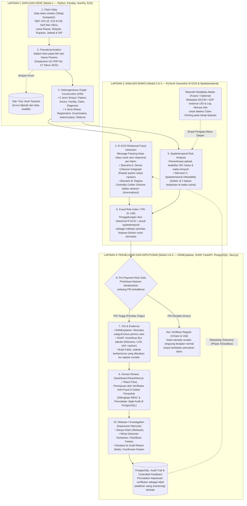
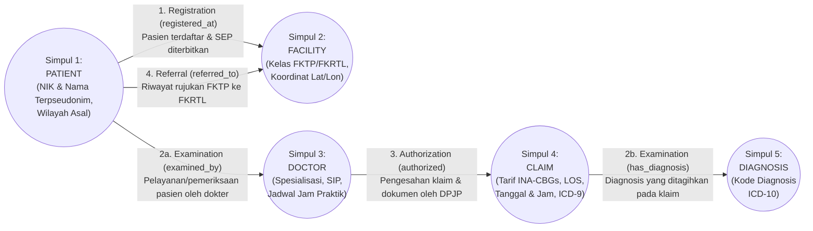
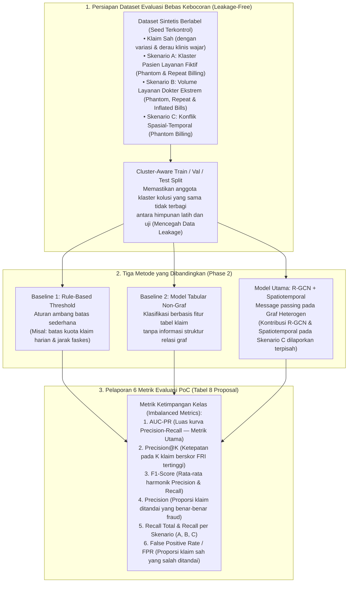
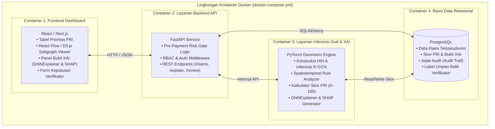

# Rancangan Arsitektur Sistem & Alur Flow Lengkap: AURA-JKN
**Autonomous Relational Anti-Fraud — Deteksi Risiko Klaim Fiktif Berbasis Graf Heterogen dan R-GCN**  
**BPJS Kesehatan Healthkathon 2026 | Tim FANTASTIC — Politeknik Negeri Indramayu**

> [!IMPORTANT]
> Dokumen ini telah **diselaraskan 100% dengan dokumen Proposal Inovasi AURA-JKN** (Bab I s/d Bab III, Gambar 1, serta Tabel 1–10) dan dipetakan langsung terhadap kode yang sudah ada di repositori ([`AURA_JKN_hetero_graph.ipynb`](file:///C:/Users/Ravli/.gemini/antigravity/scratch/Healthkathon-BPJS-KESEHATAN/AURA_JKN_hetero_graph.ipynb) dan [`train_rgcn.py`](file:///C:/Users/Ravli/.gemini/antigravity/scratch/Healthkathon-BPJS-KESEHATAN/train_rgcn.py)).

---

## 1. Matriks Keselarasan Proposal vs. Arsitektur Rancangan & Kondisi Repo

Tabel berikut memastikan tidak ada satu pun komponen di proposal yang terlewat di dalam rancangan arsitektur ini:

| Komponen pada Proposal | Referensi di Proposal | Implementasi pada Rancangan Arsitektur Ini | Status di Repo GitHub Saat Ini |
| :--- | :--- | :--- | :--- |
| **Arsitektur 10 Tahap Konseptual** | Bab II.C (Gambar 1) | Dipetakan utuh dari Tahap 1 (*Claim Data*) s/d Tahap 10 (*Release / Investigation*) + komponen opsional *Telemetri Modalitas Medis*. | Tahap 1–4 sudah ada; Tahap 5–10 dirancang di dokumen ini. |
| **Modul 1: Pseudonimisasi & Graf Heterogen (HIN)** | Bab II.C (Tabel 2) & Bab II.G (UU PDP) | Salted Hash pada NIK & Nama (kunci/salt terpisah), 5 jenis simpul (`Patient, Doctor, Facility, Claim, Diagnosis`), 4 jenis relasi (`Registration, Examination, Authorization, Referral`). | Sudah diimplementasikan di `AURA_JKN_hetero_graph.ipynb`. |
| **Modul 2: R-GCN Relational Fraud Detection** | Bab II.C (Persamaan Message Passing) | Pembaruan embedding lintas relasi: $h_i^{(l+1)} = \sigma(\sum_{r \in R}\sum_{j \in N(i,r)} \frac{1}{c_{i,r}} W_r^{(l)} h_j^{(l)} + W_0^{(l)} h_i^{(l)})$ untuk deteksi *Dense Collusive Subgraph* & *Degree Centrality Outlier* (dinormalisasi per spesialisasi & kelas RS). | Sudah diimplementasikan di `train_rgcn.py` (`AuraJKNRGCN`). |
| **Modul 3: Spatiotemporal Risk Analysis** | Bab II.C & Tabel 6 (Skenario C) | Pemeriksaan kewajaran jadwal, keaktifan SIP dokter, dan jarak tempuh antar-faskes terhadap rentang waktu layanan (*spatiotemporal infeasibility*). | Data Skenario C sudah ada; mesin aturan spatiotemporal dirancang di `src/spatiotemporal.py`. |
| **Fraud Risk Index (FRI 0–100)** | Bab II.C | Penggabungan skor relasional R-GCN dan sinyal spatiotemporal menjadi indikator prioritas 0–100 (bukan vonis otomatis). | Dirancang di `src/fri_calculator.py`. |
| **Modul 4: XAI & Evidence** | Bab II.C & Tabel 5 | **GNNExplainer** untuk visualisasi subgraf pemicu + **SHAP** untuk kontribusi fitur tabular + fakta benturan jadwal yang ditautkan ke catatan sumber. | Dirancang di `src/xai_explainer.py`. |
| **Modul 5: Pre-Payment Risk Gate & Human Review** | Bab II.C & Bab II.G | Klaim FRI rendah lanjut reguler (VClaim/Vidi); klaim FRI tinggi masuk antrean peninjauan Verifikator & Dokter Penasihat + *Controlled Feedback Loop* untuk *retraining*. | Dirancang pada layanan API & Dashboard Phase 3. |
| **Rencana Evaluasi & 2 Baseline** | Bab II.D (Tabel 6 & Tabel 8) | Pengujian 3 skenario fraud sintetis (A, B, C) menggunakan multi-seed & *cluster-aware split*, dibandingkan dengan **Baseline 1 (Aturan Ambang Batas)** dan **Baseline 2 (Model Tabular Non-Graf)** dengan metrik *Precision, Recall, F1, AUC-PR, Precision@K,* dan *FPR*. | Evaluasi R-GCN sudah ada di `train_rgcn.py`; komparasi 2 baseline & `Precision@K` dirancang di `src/evaluate_baselines.py`. |
| **Tech Stack Spesifik** | Bab II.D (Tabel 5) | `Python, Pandas, NumPy`, `PyTorch Geometric (R-GCN)`, `GNNExplainer, SHAP`, `FastAPI, PostgreSQL`, `React / Next.js + React Flow / D3.js`, dan `Docker`. | Seluruh teknologi di rancangan ini mengikuti Tabel 5 Proposal. |

---

## 2. Alur Flow 1: Arsitektur Konseptual 10 Tahap & Layanan Modular (Sesuai Gambar 1 & Tabel 5 Proposal)

Diagram ini menerjemahkan **Gambar 1 (Arsitektur Konseptual AURA-JKN)** dan **Tabel 5 (Rancangan Teknologi)** pada proposal menjadi arsitektur sistem terpadu yang dikemas dengan **Docker**:

---

## 3. Alur Flow 2: Flowchart End-to-End Panduan Tim (Visual PNG/JPG)

Gambar di bawah ini merangkum alur kerja operasional dari Langkah 1 hingga Langkah 9 dengan contoh konkret agar mudah dipahami oleh seluruh anggota tim:

---

## 4. Alur Flow 3: Skema Graf Heterogen (HIN) & Pemetaan Relasi (Sesuai Tabel 2 Proposal)

Di dalam proposal (Tabel 2), graf heterogen dirancang memiliki **5 jenis simpul** dan **4 jenis relasi analitis** yang di dalam kode [`AURA_JKN_hetero_graph.ipynb`](file:///C:/Users/Ravli/.gemini/antigravity/scratch/Healthkathon-BPJS-KESEHATAN/AURA_JKN_hetero_graph.ipynb) direpresentasikan menjadi 5 *directed edges* (+ 5 *reverse edges* via `T.ToUndirected()` agar pesan mengalir dua arah saat *message passing*):

---

## 5. Alur Flow 4: Rencana Evaluasi Komparatif & Skenario Pengujian (Sesuai Bab II.D, Tabel 6 & Tabel 8 Proposal)

Proposal menetapkan bahwa model **R-GCN** tidak diukur menggunakan *accuracy* (karena ketimpangan kelas), melainkan dievaluasi pada **3 Skenario Fraud Sintetis** dan dibandingkan secara adil terhadap **2 Baseline** lintas *random seed*:

---

## 6. Alur Flow 5: Arsitektur Kontainer Layanan & API (Phase 3 — FastAPI, PostgreSQL, Next.js, Docker)

Sesuai **Bab II.D (Rancangan Teknologi)** pada proposal, AURA-JKN dirancang modular di mana modul graf/model, aturan spatiotemporal, layanan API, basis data PostgreSQL, dan dashboard berjalan sebagai layanan terpisah yang terhubung melalui API dan dikemas dengan **Docker**:

---

## 7. Catatan Penyelarasan Kode Repo Saat Ini terhadap Proposal (Untuk Tim)

Saat saya memeriksa kode yang sudah ada di repositori (`AURA_JKN_hetero_graph.ipynb` dan `train_rgcn.py`), ada beberapa hal yang sudah sangat bagus dan beberapa bagian yang akan kita lengkapi sesuai roadmap proposal:

1. **Sudah Sesuai di Repo Saat Ini:**
   - Sudah menggunakan 5 jenis simpul (`patient`, `doctor`, `facility`, `claim`, `diagnosis`) dan 4 kelompok relasi yang diubah menjadi graf dua arah (`ToUndirected`).
   - Sudah mengimplementasikan pseudonimisasi SHA-256 dengan salt pada `patient_id`.
   - Sudah memiliki 3 skenario fraud (`A`, `B`, `C`) dan pelatihan model GNN dengan penanganan *class imbalance* (`pos_weight`).
2. **Bagian Proposal yang Belum Ada di Repo (Siap Kita Tambahkan Bertahap):**
   - **Phase 2 Lengkap:** Script komparasi dengan **2 Baseline** (*Rule-Based Threshold* & *Model Tabular Non-Graf*) serta perhitungan metrik **`Precision@K`** dan **`False Positive Rate (FPR)`** sesuai Tabel 8 Proposal.
   - **Modul Spatiotemporal & FRI (0–100):** Modul terpisah yang menghitung jarak antar-faskes & benturan waktu layanan untuk Skenario C (sehingga kontribusi aturan spatiotemporal dan R-GCN dapat dilaporkan terpisah sesuai Bab II.D Proposal) dan menggabungkannya menjadi skor **FRI 0–100**.
   - **Phase 3 (XAI & Dashboard):** Implementasi `GNNExplainer` + `SHAP`, layanan `FastAPI` + `PostgreSQL`, serta purwarupa *Dashboard* `Next.js` + `React Flow`.
