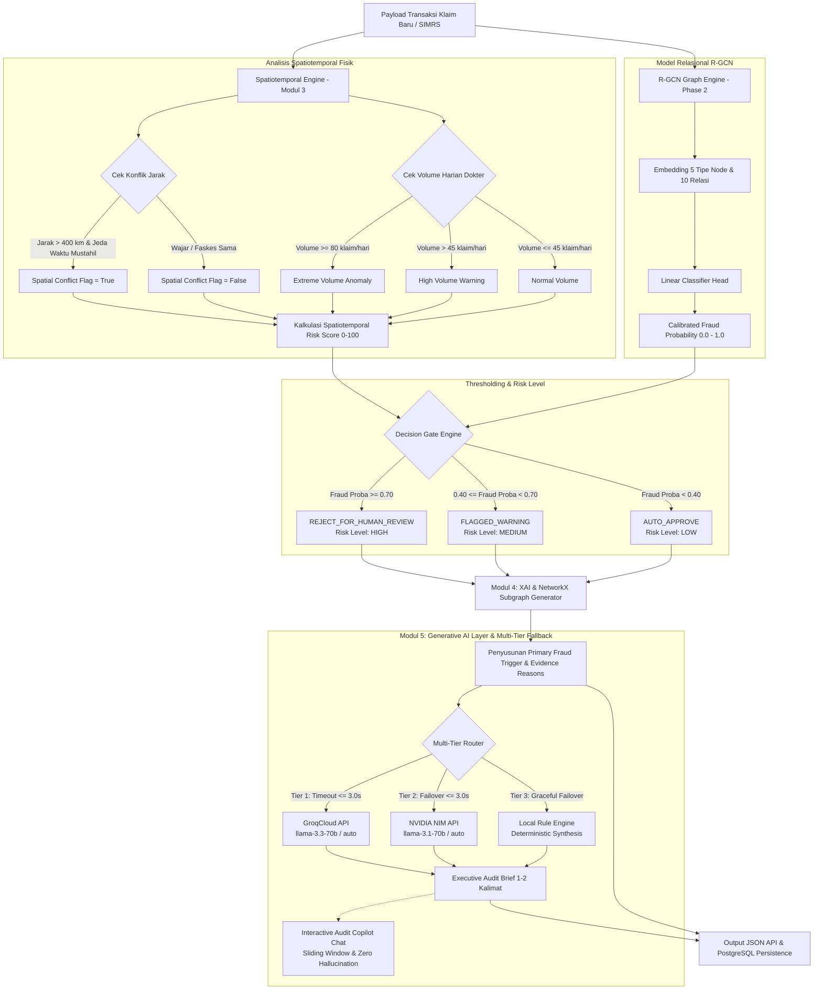
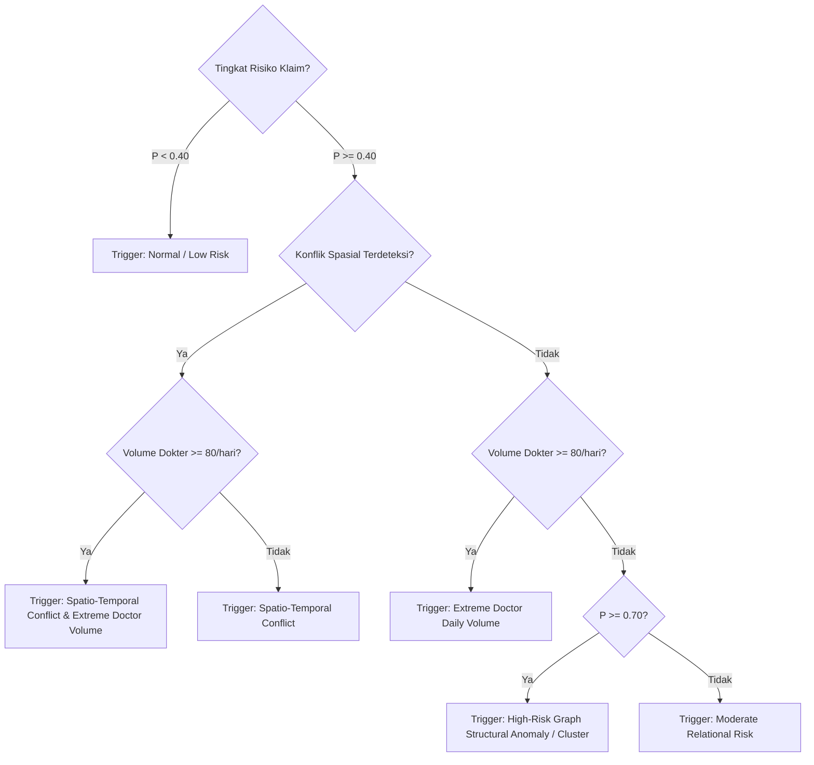

# Spesifikasi Lengkap Logika Keputusan & Klasifikasi Risiko Fraud AURA-JKN
**Dokumentasi Teknis Arsitektur Keputusan Pra-Pembayaran (Pre-Payment Gate) & Explainable AI (XAI)**  
*Healthkathon BPJS Kesehatan — Proyek AURA-JKN*

---

## 1. Ringkasan Eksekutif (Executive Summary)

Sistem **AURA-JKN** mengimplementasikan arsitektur **Hybrid AI Pipeline (ML + LLM)** dengan mekanisme **Pre-Payment Verification Gate** untuk memitigasi klaim fiktif dan kecurangan (*fraud*) pada tagihan klaim BPJS Kesehatan sebelum dana dicairkan ke Fasilitas Kesehatan (Faskes).

Keputusan akhir sebuah klaim tidak hanya bergantung pada probabilitas matematis dari satu model saja, melainkan hasil sintesis komprehensif dari **empat pilar analitik terintegrasi**:
1. **Relational Graph Convolutional Network (R-GCN - Phase 2)**: Menangkap anomali topologi multi-relasi antara Pasien, Dokter, Faskes, Klaim, dan Diagnosis.
2. **Spatiotemporal Integrity Engine (Modul 3)**: Menganalisis batasan fisik dunia nyata (kecepatan perpindahan faskes dokter/pasien dan anomali volume klaim harian dokter).
3. **Explainable AI (XAI) & Subgraph Extractor (Modul 4)**: Menyusun bukti rantai kausalitas dan subgraf relasional ego-network untuk memvalidasi alasan penolakan.
4. **Generative AI Layer & Interactive Audit Copilot (Modul 5)**: Mensintesis *Executive Audit Brief* 1–2 kalimat secara otomatis dan menyediakan *Interactive Audit Copilot Chat* untuk verifikator BPJS dengan garansi keandalan *Zero HTTP 500 Failure*.

---

## 2. Diagram Alur Keputusan End-to-End



---

## 3. Matriks Ambang Batas (Threshold Matrix)

Sistem memetakan probabilitas kontinu menjadi tiga kategori tindakan operasional pre-payment:

| Status Pre-Payment Gate | Tingkat Risiko (*Risk Level*) | Rentang Nilai Probabilitas ($P$) | Dampak pada Pembayaran Klaim | SLA Tindakan |
| :--- | :---: | :---: | :--- | :--- |
| **`REJECT_FOR_HUMAN_REVIEW`** | **`HIGH`** | **$P \ge 0.70$** (70% – 100%) | **Pencairan dana dibekukan sementara.** Klaim masuk antrean khusus audit manual tim verifikator BPJS beserta subgraf bukti kausalitas. | Review manual maksimal $2 \times 24$ jam. |
| **`FLAGGED_WARNING`** | **`MEDIUM`** | **$0.40 \le P < 0.70$** (40% – 69%) | **Pencairan diproses bersyarat.** Klaim ditandai sebagai sampel dalam *post-audit sampling* berkala. | Sampling audit mingguan. |
| **`AUTO_APPROVE`** | **`LOW`** | **$P < 0.40$** (0% – 39%) | **Pencairan instan (*Straight-Through Processing*).** Klaim langsung disetujui tanpa intervensi manusia. | Instan / Real-time ($< 50\text{ ms}$). |

---

## 4. Logika & Syarat Penentuan Skenario (*Primary Fraud Trigger*)

Ketika sebuah klaim diidentifikasi memiliki risiko tinggi ($P \ge 0.70$) atau masuk zona peringatan ($P \ge 0.40$), sistem mengevaluasi hierarki kondisi berbasis aturan kausalitas untuk menentukan label **`primary_fraud_trigger`**:



### Rincian Syarat Spesifik Setiap Skenario

#### A. Skenario C: *Spatio-Temporal Conflict* (Impossible Travel)
* **Karakteristik Kasus**: Pasien atau dokter yang sama tercatat melakukan pelayanan medis pada dua faskes yang berjarak sangat jauh dalam kurun waktu yang tidak masuk akal secara fisik di hari yang sama.
* **Syarat Formal**:
  1. Ditemukan klaim lain pada tanggal yang sama ($D_{\text{klaim\_1}} = D_{\text{klaim\_2}}$) dengan ID Dokter atau ID Pasien yang identik.
  2. Faskes berbeda ($F_1 \neq F_2$).
  3. Selisih koordinat geografis $|\text{Lat}_1 - \text{Lat}_2| \ge 4.5^\circ$ **atau** $|\text{Lon}_1 - \text{Lon}_2| \ge 4.5^\circ$.
  4. Jarak Haversine $d(F_1, F_2) \ge 400\text{ km}$.
* **Contoh Narasi Bukti**:
  > *"Dokter DOC0040 melayani klaim di faskes FAC0013 dan FAC0008 berjarak ~3,794 km pada hari yang sama (Konflik Spasio-Temporal)."*

#### B. Skenario B: *Extreme Doctor Daily Volume* (Phantom / Over-servicing)
* **Karakteristik Kasus**: Dokter menyetujui kuantitas klaim dalam sehari yang melampaui batas kemampuan fisik seorang tenaga medis.
* **Syarat Formal**:
  1. $V_{\text{harian}} = \text{Count}(\text{Klaim disetujui dokter } D \text{ pada tanggal } T)$.
  2. Ambang batas normal peer: $\bar{V}_{\text{peer}} \approx 25\text{ klaim/hari}$.
  3. Kapasitas maksimum wajar: $V_{\text{limit}} = 45\text{ klaim/hari}$.
  4. **Syarat Anomali Ekstrem**: $V_{\text{harian}} \ge 80\text{ klaim/hari}$ ($>300\%$ dari rata-rata peer).
* **Contoh Narasi Bukti**:
  > *"Dokter DOC0086 memproses 142 klaim pada tanggal 2026-03-15 (315% dari ambang batas kapasitas normal 45 klaim/hari)."*

#### C. Skenario A: *Suspicious Patient Referral Cluster / Phantom Billing*
* **Karakteristik Kasus**: Terkonsentrasinya klaim dari sekelompok pasien dari satu wilayah tertentu pada satu faskes/dokter rujukan lanjutan tanpa adanya riwayat surat rujukan sah dari FKTP (Fasilitas Kesehatan Tingkat Pertama).
* **Syarat Formal**:
  1. Node klaim tidak memiliki relasi rujukan sah: $\text{Edge}(P, \texttt{referred\_to}, F) = \emptyset$ atau faskes terdaftar tidak sesuai jejaring rujukan regional.
  2. Prediksi model R-GCN tinggi ($P \ge 0.70$) akibat klaster topologis heterogen abnormal.
* **Contoh Narasi Bukti**:
  > *"Model R-GCN mendeteksi klaster rujukan abnormal: Pasien tidak memiliki histori kunjungan FKTP terdaftar untuk rujukan faskes lanjutan."*

#### D. Skenario Normal: *Low Risk / Clean Claim*
* **Syarat Formal**:
  1. $P < 0.40$.
  2. $\text{Spatial Conflict} = \text{False}$.
  3. $V_{\text{harian}} \le 45\text{ klaim/hari}$.
* **Contoh Narasi Bukti**:
  > *"Parameter transaksi konsisten dengan profil wajar dan lolos verifikasi pra-pembayaran."*

---

## 5. Formulasi Matematis

### A. Jarak Geografis Haversine
Untuk menghitung jarak terpendek antara dua fasilitas kesehatan $F_1(\phi_1, \lambda_1)$ dan $F_2(\phi_2, \lambda_2)$ di atas kelengkungan bumi:

$$\Delta\phi = \phi_2 - \phi_1, \quad \Delta\lambda = \lambda_2 - \lambda_1$$

$$a = \sin^2\left(\frac{\Delta\phi}{2}\right) + \cos(\phi_1)\cos(\phi_2)\sin^2\left(\frac{\Delta\lambda}{2}\right)$$

$$c = 2 \cdot \text{atan2}\left(\sqrt{a}, \sqrt{1 - a}\right)$$

$$d = R \cdot c \quad (\text{dengan } R = 6.371\text{ km})$$

### B. Spatiotemporal Risk Score ($S_{\text{st}}$)
Skor komposit skala $0.0 - 100.0$ dihitung dengan rumus:

$$S_{\text{st}} = \min\left(100.0, \; S_{\text{spatial}} + S_{\text{volume}}\right)$$

Dengan komponen:
* **Komponen Spasial ($S_{\text{spatial}}$)**:
  $$S_{\text{spatial}} = \begin{cases} 55.0, & \text{jika } \text{Spatial Conflict} = \text{True} \\ 0.0, & \text{jika } \text{Spatial Conflict} = \text{False} \end{cases}$$

* **Komponen Volume Dokter ($S_{\text{volume}}$)**:
  $$S_{\text{volume}} = \begin{cases} 
  40.0, & \text{jika } V \ge 80 \\
  \min(30.0, \; (V - 45) \times 1.0), & \text{jika } 45 < V < 80 \\
  \left(\frac{V}{45}\right) \times 10.0, & \text{jika } V \le 45 
  \end{cases}$$

---

## 6. Struktur Representasi Bukti XAI (NetworkX Subgraph)

Untuk memastikan prinsip *Human-in-the-Loop*, setiap klaim yang dievaluasi diekstrakkan lingkungan subgraf 1-hop dan 2-hop sekitarnya:

```text
(Patient) --- [examined_by] ----> (Doctor) --- [authorized] ---> (Claim)
    |                                 |                             |
    +-------- [referred_to] --------> (Facility)            [has_diagnosis]
                                      |                             |
                       [concurrent_practice_conflict]           (Diagnosis)
                                      |
                           (Conflicting Facility)
```

Struktur JSON subgraf ini menyajikan daftar `nodes` dan `edges` berbobot ringan yang dapat langsung dikonsumsi oleh visualizer frontend (misal Cytoscape.js, D3.js, atau ECharts).

---

## 7. Generative AI Layer & Multi-Tier Fallback Architecture (Modul 5)

Sebagai pelengkap penjelasan matematis dan visualisasi subgraf, AURA-JKN mengintegrasikan **Generative AI Layer** untuk mengonversi data analitik teknis menjadi narasi eksekutif yang ramah auditor serta memungkinkan tanya-jawab interaktif.

### A. Fitur Utama Generative AI
1. **Executive Audit Brief (`audit_brief`)**:
   - Menghasilkan ringkasan naratif 1–2 kalimat yang padat dan actionable secara instan pada setiap inferensi pra-bayar.
   - Mengombinasikan putusan *Decision Gate*, probabilitas kecurangan R-GCN, serta rincian pelanggaran fisik spatiotemporal.
2. **Interactive Audit Copilot Chat (`/api/v1/claims/{claim_id}/chat`)**:
   - Memfasilitasi dialog dua arah antara verifikator BPJS dan AI Copilot mengenai klaim tertentu.
   - Dibatasi oleh *strict isolated context* klaim terkait untuk mencegah halusinasi data klaim lain.

### B. Spesifikasi Multi-Tier Fallback Router (Zero HTTP 500 Guarantee)
Untuk menjamin keandalan level enterprise dalam lingkungan produksi tanpa toleransi downtime (*Zero HTTP 500 Failure*), layanan LLM menerapkan arsitektur *failover* bertingkat:

| Tingkatan (*Tier*) | Provider & Model | Latency Budget | Peran & Kondisi Eksekusi |
| :--- | :--- | :---: | :--- |
| **Tier 1 (Primary)** | **GroqCloud API**<br/>`llama-3.3-70b-versatile` / `auto` | $\le 3.0\text{ s}$ | Pilihan utama dengan latensi inferensi ultra-rendah melalui LPU. |
| **Tier 2 (Secondary)**| **NVIDIA NIM API**<br/>`meta/llama-3.1-70b-instruct` / `auto` | $\le 3.0\text{ s}$ | Failover otomatis jika Groq mengalami *rate limit* (429), timeout, atau jaringan terputus. |
| **Tier 3 (Tertiary)** | **Local Rule Engine**<br/>*(Deterministic Pattern Synthesizer)* | $< 1\text{ ms}$ | Fallback deterministik lokal di memori jika seluruh penyedia cloud offline/tidak tersedia. |

### C. Dynamic Model Discovery & Self-Healing Architecture
Mengantisipasi perubahan katalog dan masa pensiun (*End of Life*) model di penyedia LLM cloud:
- **Konfigurasi `auto`**: Jika `GROQ_MODEL=auto` atau `NVIDIA_MODEL=auto`, modul melakukan inspeksi live ke endpoint `/models` provider, menyaring model khusus chat/teks yang berstatus aktif, dan memilih model prioritas tertinggi secara otomatis.
- **Self-Healing Interceptor**: Jika pemanggilan model tertentu menghasilkan HTTP 404 (*model_not_found*) atau HTTP 410 (*Gone*), sistem menghapus cache model kedaluwarsa, mengulang proses seleksi model alternatif dari katalog aktif, dan mencoba ulang panggilan secara transparan tanpa intervensi manual pengembang.

### D. Persona Enforcer & Zero Hallucination Bounding
Modul menyuntikkan instruksi sistem yang mengikat model ke persona resmi:
> *"Anda adalah Asisten Audit Verifikator Klaim BPJS Kesehatan (AURA-JKN). Tugas Anda adalah memberikan analisis objektif, formal, ringkas, dan berbasis data berdasarkan fakta klaim yang terlampir. DILARANG mengarang fakta atau mengasumsikan data di luar konteks yang diberikan."*

### E. Optimasi Performa & Latensi
1. **Sliding Window Token Management**: Untuk endpoint Copilot Chat, riwayat percakapan dibatasi hanya pada $3-5$ pesan terakhir (`chat_history[-5:]`) untuk menghemat konsumsi token dan menghindari penolakan kuota *free-tier*.
2. **Persistent HTTP Connection Pooling**: Menggunakan instance global `httpx.AsyncClient` yang dikelola melalui FastAPI `lifespan` context manager untuk mengeliminasi overhead *handshake* TCP/TLS pada setiap panggilan LLM.

---

## 8. Kesimpulan Operasional bagi Auditor BPJS

1. **Efisiensi Beban Verifikator**: Sistem membebaskan verifikator dari 80%+ klaim legal melalui fitur `AUTO_APPROVE` (*Straight-Through Processing*).
2. **Prioritisasi Review Cerdas**: Tim auditor hanya fokus pada antrean klaim `REJECT_FOR_HUMAN_REVIEW` yang telah dilengkapi bukti tekstual spesifik, visualisasi subgraf ego, serta ringkasan narasi eksekutif LLM.
3. **Audit Interaktif Berbasis Bukti**: Auditor dapat berdiskusi secara interaktif melalui Copilot Chat untuk mendalami kejanggalan klaim sebelum menerbitkan surat penolakan resmi.
4. **Keandalan Tanpa Gagal (*Zero Downtime*)**: Mekanisme Multi-Tier Fallback menjamin sistem tetap beroperasi normal 100% bahkan saat terjadi gangguan pada konektivitas AI cloud.
5. **Akuntabilitas Keputusan**: Keputusan sistem tidak berupa *black-box*, melainkan dapat diaudit ulang (*reproducible*) berkat kombinasi aturan fisik spatiotemporal, graf relasional XAI, dan persistensi otomatis PostgreSQL.
