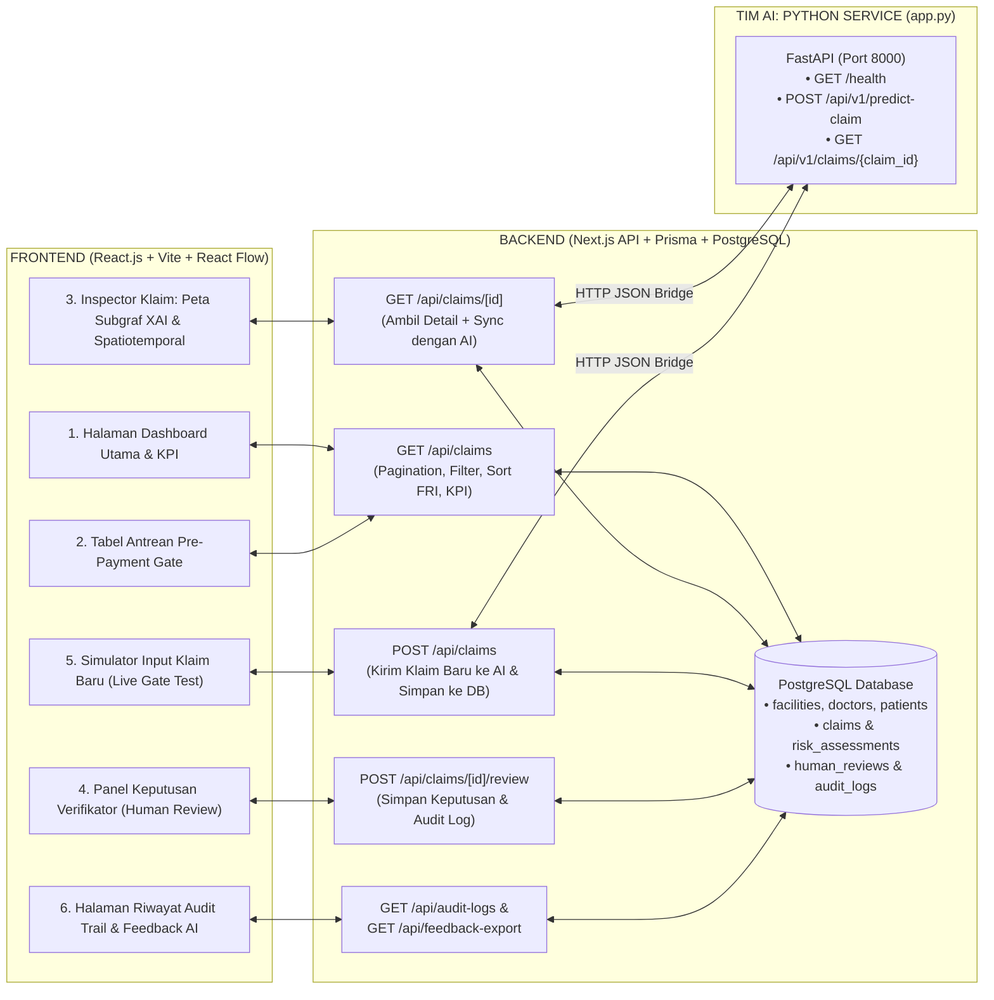

# Analisis Sistem & Master Plan Implementasi: Backend (Next.js + PostgreSQL) & Frontend (React.js)
**Fokus Peran:** Fullstack Web Developer (Backend Next.js + Database PostgreSQL + Frontend React.js)  
**Batas Peran:** Tidak mengubah/melatih model AI Python (`train_rgcn.py` / `AURA_JKN_hetero_graph.ipynb`), melainkan mengintegrasikan output mesin AI (`app.py`) ke dalam sistem operasional Pre-Payment Gate & Dashboard Verifikator BPJS Kesehatan.

---

## BAGIAN 1: Analisis Bedah Sistem Saat Ini

Berdasarkan pemeriksaan menyeluruh terhadap **Proposal AURA-JKN**, dokumen **[DECISION_LOGIC_AND_CLASSIFICATION_RULES.md](./DECISION_LOGIC_AND_CLASSIFICATION_RULES.md)**, dan kode AI Engineer di **[app.py](../app.py)**, berikut adalah kondisi faktual sistem saat ini:

### 1. Apa yang Sudah Disediakan oleh Tim AI Engineer di `app.py`?
Tim AI telah membuat *microservice* inferensi berbasis FastAPI (Python) yang berfungsi sebagai **Kalkulator Risiko Klaim Tunggal**:
* **Input yang diterima AI (`POST /api/v1/predict-claim` atau `GET /api/v1/claims/{claim_id}`):**
  Data transaksi 1 klaim (`claim_id`, `patient_id`, `doctor_id`, `facility_id`, `icd10_code`, `service_date`, `service_time`, `ina_cbgs_tariff`, `length_of_stay`).
* **Output yang dikeluarkan AI (`ClaimPredictionResponse`):**
  1. `fraud_probability` ($0.0 - 1.0$) $\rightarrow$ di sistem dikonversi menjadi **Fraud Risk Index / FRI ($0 - 100$)**.
  2. `risk_level`: `HIGH` ($P \ge 0.70$), `MEDIUM` ($0.40 \le P < 0.70$), atau `LOW` ($P < 0.40$).
  3. `pre_payment_gate`:
     * `REJECT_FOR_HUMAN_REVIEW` (Dana ditahan sementara, wajib masuk antrean verifikator maksimal $2 \times 24\text{ jam}$).
     * `FLAGGED_WARNING` (Pencairan bersyarat, masuk daftar *post-audit sampling* mingguan).
     * `AUTO_APPROVE` (*Straight-Through Processing* / langsung lolos tanpa hambatan).
  4. `spatiotemporal_metrics`:
     * `spatial_conflict_detected` (`true`/`false` jika jarak Haversine antar-faskes di hari yang sama $\ge 400\text{ km}$).
     * `doctor_daily_volume` (jumlah klaim dokter di hari tersebut; normal $\le 45$, ekstrem $\ge 80$).
     * `spatiotemporal_risk_score` ($0.0 - 100.0$).
  5. `xai_explanation`:
     * `primary_fraud_trigger` (Label skenario pemicu utama).
     * `evidence_reasons` (Array kalimat penjelasan bukti anomali).
     * `subgraph_evidence` (Objek `nodes` dan `edges` dari 5 entitas: `claim`, `doctor`, `facility`, `patient`, `diagnosis` + `concurrent_practice_conflict`).

### 2. Celah Sistem yang Menjadi Tanggung Jawab Developer Backend (Next.js + PostgreSQL) & Frontend (React.js)
Mesin AI di `app.py` bersifat **stateless** (hanya menghitung skor 1 klaim saat dipanggil, tidak menyimpan proses kerja verifikator). Oleh karena itu, sistem membutuhkan **Backend Next.js + PostgreSQL** dan **Frontend React.js** untuk menangani 5 hal krusial sesuai proposal:
1. **Persistence & Queue Management (PostgreSQL):** Menyimpan ribuan klaim beserta hasil skor AI ke tabel PostgreSQL agar bisa diurutkan berdasarkan FRI tertinggi, difilter per Skenario (A/B/C), dicari berdasarkan ID Klaim/Dokter/Faskes, dan dihitung ringkasan finansialnya (total nominal klaim yang berhasil ditahan).
2. **Pre-Payment Gate Workflow & SLA Tracking:** Mengelola status siklus hidup klaim di dunia nyata (`AUTO_APPROVED`, `PENDING_HUMAN_REVIEW`, `WAITING_CLARIFICATION`, `RELEASED_AFTER_REVIEW`, `CONFIRMED_FRAUD_ESCALATED`).
3. **Human-in-the-Loop Review & RBAC (Modul 5 Proposal):** Menyediakan fitur bagi **Verifikator Anti-Fraud** dan **Dokter Penasihat** untuk memberi keputusan (*Release*, *Minta Klarifikasi CPPT/Resume Medis*, atau *Eskalasi Audit*) lengkap dengan pencatatan **Audit Trail** yang tidak bisa diubah (*immutable log*).
4. **Controlled Feedback Loop untuk Tim AI:** Menyimpan keputusan akhir manusia (`feedback_label`: `0` = Klaim Sah, `1` = Terbukti Fraud) di PostgreSQL dan menyediakan endpoint ekspor agar tim AI bisa mengambil data tersebut untuk *retraining* model R-GCN.
5. **Interactive Investigative Dashboard (Modul 4 Proposal):** Menampilkan peta visualisasi subgraf (`nodes` & `edges` dari AI) secara interaktif menggunakan **React Flow**, menampilkan panel alasan XAI, indikator Spatiotemporal, serta simulator pengajuan klaim baru (*Live Pre-Payment Gate Simulator*).

---

## BAGIAN 2: Arsitektur Integrasi Antara Backend/Frontend dan Tim AI

---

## BAGIAN 3: Master Plan Implementasi (Tahapan Kerja BE & FE)

Berikut adalah rencana kerja terstruktur yang dibagi menjadi **5 Fase (Milestone)** berurutan:

### Fase 1: Desain & Finalisasi Database PostgreSQL (Prisma ORM)
**Tujuan:** Memastikan seluruh data klaim, hasil analisis AI, keputusan verifikator, dan jejak audit tersimpan rapi sesuai UU PDP dan kebutuhan proposal.
* **Task 1.1 — Skema Entitas Master (`backend/prisma/schema.prisma`):**
  * Tabel `facilities` (`facility_id`, `facility_class` FKTP/FKRTL, `latitude`, `longitude`).
  * Tabel `doctors` (`doctor_id`, `sip_number`, `specialty`, `home_facility_id`, `schedule_hours`).
  * Tabel `patients` (`patient_id` berupa *Salted SHA-256 Hash*, `home_region` — tanpa menyimpan NIK/Nama asli sesuai UU PDP).
* **Task 1.2 — Skema Transaksi Klaim & Hasil AI (`claims` & `risk_assessments`):**
  * Menyimpan atribut klaim (`icd10_code`, `icd9_code`, `service_date`, `service_time`, `ina_cbgs_tariff`, `length_of_stay`, `fraud_scenario`).
  * Menyimpan seluruh output JSON dari `app.py` (`fraud_probability`, `fraud_risk_index` 0–100, `risk_level`, `pre_payment_gate`, `spatial_conflict_detected`, `doctor_daily_volume`, `spatiotemporal_risk_score`, `primary_fraud_trigger`, `evidence_reasons`, dan `subgraph_evidence`).
* **Task 1.3 — Skema Operasional Verifikator & Tata Kelola (`human_reviews` & `audit_logs`):**
  * Menyimpan riwayat keputusan verifikator (`RELEASE`, `CLARIFY`, `ESCALATE_AUDIT`), peran pemeriksa (`VERIFIKATOR_BPJS`, `DOKTER_PENASIHAT`), catatan investigasi, waktu SLA, serta `feedback_label` (`0` atau `1`).
* **Task 1.4 — Script Seeding & Sinkronisasi Batch (`backend/prisma/seed.ts`):**
  * Membuat script seeder untuk memuat klaim sampel representatif (Skenario A, B, C, dan Normal) dari data Parquet/AI ke dalam PostgreSQL agar database langsung terisi saat diuji juri atau tim.

---

### Fase 2: Pengembangan Layanan Backend (Next.js API Routes)
**Tujuan:** Membangun jembatan antara Frontend React.js, Database PostgreSQL, dan layanan Python AI (`app.py`).
* **Task 2.1 — Modul Konektor AI (`AI Bridge Service`):**
  * Membuat fungsi *client* di Next.js yang memanggil `http://127.0.0.1:8000/api/v1/predict-claim` dan `GET /api/v1/claims/{claim_id}` milik tim AI, dilengkapi *timeout handling* dan *fallback* otomatis apabila server Python sedang mati saat demo.
* **Task 2.2 — Endpoint Antrean & Statistik KPI (`GET /api/claims`):**
  * Mendukung filter berdasarkan:
    * `risk_level`: `HIGH`, `MEDIUM`, `LOW`
    * `pre_payment_gate`: `REJECT_FOR_HUMAN_REVIEW`, `FLAGGED_WARNING`, `AUTO_APPROVE`
    * `scenario`: `A` (Klaster Pasien Fiktif), `B` (Volume Dokter Ekstrem), `C` (Konflik Spasial-Temporal), `NORMAL`
    * `review_status`: `PENDING_REVIEW`, `RELEASED`, `CLARIFICATION_REQUESTED`, `ESCALATED_AUDIT`
    * Pencarian teks bebas (`claim_id`, `doctor_id`, `facility_id`, `icd10_code`).
  * Menghitung agregasi KPI secara *real-time* (Total Klaim, Jumlah Klaim Ditahan, Rata-rata FRI, dan **Total Nominal Rupiah Klaim Berisiko Tinggi yang Berhasil Ditahan Pra-Pembayaran**).
* **Task 2.3 — Endpoint Simulasi Klaim Baru (`POST /api/claims`):**
  * Menerima input form klaim baru (seolah-olah klaim baru masuk dari VClaim RS), meneruskannya ke `POST /api/v1/predict-claim` di `app.py`, menyimpan hasilnya ke PostgreSQL, dan mengembalikan keputusan *Pre-Payment Gate* secara *real-time*.
* **Task 2.4 — Endpoint Eksekusi Human Review & Audit Trail (`POST /api/claims/[claimId]/review` & `GET /api/audit-logs`):**
  * Memvalidasi input keputusan verifikator, memperbarui status klaim di PostgreSQL, mencatat entri baru di tabel `audit_logs`, dan menyiapkan endpoint `GET /api/feedback-export` (format JSON/CSV) yang bisa diambil oleh tim AI untuk *retraining* model.

---

### Fase 3: Pengembangan Frontend Dashboard Investigatif (React.js + Tailwind + React Flow)
**Tujuan:** Membangun antarmuka visual yang intuitif bagi Verifikator BPJS Kesehatan dan siap didemokan di hadapan juri Healthkathon.
* **Task 3.1 — Header Diagnostik & Kartu KPI Eksekutif:**
  * Menampilkan indikator status koneksi *Backend PostgreSQL* & *AI Engine R-GCN*.
  * Menampilkan 4 kartu metrik utama (Total Klaim Dianalisis, Antrean `REJECT_FOR_HUMAN_REVIEW`, Antrean `FLAGGED_WARNING`, dan Nominal Dana DJS yang Diamankan dalam Rupiah).
* **Task 3.2 — Tabel Antrean Prioritas Pre-Payment Gate:**
  * Menampilkan daftar klaim yang diurutkan dari skor **FRI tertinggi (mendekati 100)** ke terendah.
  * Dilengkapi *badge* warna tingkat risiko (`HIGH` merah, `MEDIUM` kuning, `LOW` hijau), tag skenario (`Skenario A/B/C`), status review, serta fitur *search & filter*.
* **Task 3.3 — Visualisasi Peta Subgraf Interaktif (`SubgraphViewer` dengan React Flow):**
  * Merender `subgraph_evidence.nodes` dan `subgraph_evidence.edges` dari AI menjadi diagram jaringan interaktif:
    * Membedakan warna dan ikon untuk 5 jenis simpul: **Klaim**, **Dokter (DPJP)**, **Faskes (FKTP/FKRTL)**, **Pasien (Hash Pseudonim)**, dan **Diagnosis (ICD-10)**.
    * Memberi *highlight* garis merah beranimasi khusus pada relasi konflik (`concurrent_practice_conflict` pada Skenario C) atau pemusatan rujukan pada Skenario A.
* **Task 3.4 — Panel Bukti XAI & Indikator Fisik Spatiotemporal:**
  * Menampilkan **Primary Fraud Trigger** dan poin-poin kalimat bukti (`evidence_reasons`).
  * Menampilkan kartu metrik fisik:
    * Status **Konflik Spasial-Temporal** (Terdeteksi jarak $>400\text{ km}$ vs Aman).
    * Indikator **Volume Klaim Harian Dokter** dibandingkan batas normal ($45\text{ klaim/hari}$) dan batas ekstrem ($80\text{ klaim/hari}$).
    * Nilai **Spatiotemporal Risk Score** ($0 - 100$).
* **Task 3.5 — Panel Keputusan Verifikator (*Human-in-the-Loop*) & Riwayat Review:**
  * Form input nama/peran pemeriksa (*Verifikator BPJS* / *Dokter Penasihat*) dan catatan investigasi.
  * 3 tombol aksi sesuai proposal:
    1. **Setujui Klaim (`RELEASE`)** $\rightarrow$ Lepas penahanan pembayaran.
    2. **Minta Klarifikasi Faskes (`CLARIFY`)** $\rightarrow$ Minta RS unggah bukti tambahan (CPPT, Resume Medis, log kehadiran).
    3. **Tahan & Eskalasi Audit (`ESCALATE_AUDIT`)** $\rightarrow$ Teruskan ke tim audit rekam medis / konfirmasi pasien.
  * Menampilkan daftar riwayat review (*Audit Trail*) di bawah klaim yang sudah pernah ditinjau.
* **Task 3.6 — Modal / Halaman "Simulasi Klaim Baru (Live Pre-Payment Gate)":**
  * Fitur khusus untuk **Demo Presentasi**: Pengguna/juri bisa memasukkan data klaim baru (atau memilih *preset* Skenario A/B/C/Normal), menekan tombol **"Uji Klaim ke Pre-Payment Gate"**, dan melihat bagaimana sistem secara *real-time* menghitung skor FRI, menahan/meloloskan klaim, dan menggambar subgraf XAI-nya.

---

### Fase 4: Integrasi End-to-End & Pengujian Bersama Tim AI
**Tujuan:** Memastikan ketiga komponen (`frontend` port 5173 $\leftrightarrow$ `backend` port 3001 $\leftrightarrow$ `app.py` port 8000 + `postgres` port 5432) berjalan mulus secara bersamaan.
* **Task 4.1 — Uji Kontrak JSON (`Contract Testing`):**
  * Menjalankan `uvicorn app:app --port 8000` (milik tim AI) bersamaan dengan `backend` dan `frontend`, lalu menguji klik klaim `CLMC00001104` (Skenario C) dan `CLM00010650` (Normal) dari layar React.js.
* **Task 4.2 — Penanganan Edge Case:**
  * Memastikan jika tim AI memperbarui model `.pt` atau menambah atribut baru di `app.py`, skema di `backend` dan `frontend` tetap kompatibel tanpa *error*.

---

### Fase 5: Pengemasan Docker & Persiapan Demo Kompetisi
**Tujuan:** Memudahkan seluruh anggota tim dan juri menjalankan sistem di laptop mana pun.
* **Task 5.1 — Kontainerisasi Layanan (`docker-compose.yml`):**
  * Menyediakan layanan `postgres` (dan opsional `backend`, `frontend`, serta `ai-service`) dalam satu konfigurasi `docker-compose.yml` sesuai Tabel 5 Proposal.
* **Task 5.2 — Skenario Walkthrough Demo:**
  * Menyiapkan urutan skenario klik di Dashboard untuk demonstrasi 5 menit (menunjukkan klaim normal yang langsung `AUTO_APPROVE`, klaim Skenario A/B/C yang tertahan di `REJECT_FOR_HUMAN_REVIEW`, bukti subgraf XAI, hingga verifikator menekan tombol keputusan).
